# Securing the Future with Quantum Computing and Cryptography — Learner Guide

**WSQ Course Code:** TGS-2024043419  |  **Conducted by:** Tertiary Infotech Academy Pte Ltd (UEN 201200696W)  |  **Version v13.0 · 11 August 2026**

## Contents

- [Introduction](#introduction)
- [Course Learning Outcomes](#course-learning-outcomes)
- [Before You Start — Environment Setup](#before-you-start--environment-setup)
- [Prerequisites — The Mathematics of Quantum Mechanics](#prerequisites--the-mathematics-of-quantum-mechanics)
  - [Linear Algebra You Actually Need](#linear-algebra-you-actually-need)
  - [Unitary Operators — Why Every Gate Is Reversible](#unitary-operators--why-every-gate-is-reversible)
  - [Density Matrices — Mixed States and Noise](#density-matrices--mixed-states-and-noise)
  - [The Five Postulates of Quantum Mechanics](#the-five-postulates-of-quantum-mechanics)
- [Topic 01 — Quantum Physics Fundamentals](#topic-01--quantum-physics-fundamentals)
  - [Activity 1 — Linear Algebra for Quantum Mechanics in Python](#activity-1--linear-algebra-for-quantum-mechanics-in-python)
- [Topic 02 — Introduction to Quantum Computing Systems](#topic-02--introduction-to-quantum-computing-systems)
  - [Activity 2 — Visualising a Qubit on the Bloch Sphere](#activity-2--visualising-a-qubit-on-the-bloch-sphere)
  - [Activity 3 — Superposition and Entanglement on IBM Quantum](#activity-3--superposition-and-entanglement-on-ibm-quantum)
- [Topic 03 — Quantum Gates and Circuits](#topic-03--quantum-gates-and-circuits)
  - [Proof — Phase Kickback](#proof--phase-kickback)
  - [Activity 4 — Building Circuits in IBM Quantum Composer](#activity-4--building-circuits-in-ibm-quantum-composer)
  - [Activity 5 — Quantum Gates and Bell/GHZ States with PennyLane](#activity-5--quantum-gates-and-bellghz-states-with-pennylane)
- [Topic 04 — Quantum Protocols](#topic-04--quantum-protocols)
  - [Proof — Quantum Teleportation](#proof--quantum-teleportation)
  - [Proof — The No-Cloning Theorem](#proof--the-no-cloning-theorem)
  - [Proof — BB84 Security and Eavesdropper Detection](#proof--bb84-security-and-eavesdropper-detection)
  - [Proof — The CHSH Inequality and Bell Violation](#proof--the-chsh-inequality-and-bell-violation)
  - [Proof — Superdense Coding](#proof--superdense-coding)
  - [Activity 6 — Quantum Teleportation](#activity-6--quantum-teleportation)
  - [Activity 7 — Superdense Coding Protocol](#activity-7--superdense-coding-protocol)
  - [Activity 8 — BB84 Quantum Key Distribution with Eavesdropping Detection](#activity-8--bb84-quantum-key-distribution-with-eavesdropping-detection)
- [Topic 05 — Quantum Algorithms](#topic-05--quantum-algorithms)
  - [Quantum Phase Estimation](#quantum-phase-estimation)
  - [The Quantum Fourier Transform](#the-quantum-fourier-transform)
  - [Proof — The Deutsch Algorithm](#proof--the-deutsch-algorithm)
  - [Proof — Deutsch-Jozsa (n qubits)](#proof--deutsch-jozsa-n-qubits)
  - [Proof — Grover's Algorithm and the √N Speedup](#proof--grovers-algorithm-and-the-n-speedup)
  - [Proof — The Quantum Fourier Transform is Efficient](#proof--the-quantum-fourier-transform-is-efficient)
  - [Activity 9 — Deutsch and Deutsch-Jozsa Algorithms](#activity-9--deutsch-and-deutsch-jozsa-algorithms)
  - [Activity 10 — Bernstein-Vazirani Algorithm](#activity-10--bernstein-vazirani-algorithm)
  - [Activity 11 — Grover's Search Algorithm](#activity-11--grovers-search-algorithm)
  - [Activity 12 — Quantum Fourier Transform](#activity-12--quantum-fourier-transform)
- [Topic 06 — Quantum Cryptography and Quantum Safety](#topic-06--quantum-cryptography-and-quantum-safety)
  - [Post-Quantum Hardening — Practical Migration](#post-quantum-hardening--practical-migration)
  - [Quantum Security — The Complete Picture](#quantum-security--the-complete-picture)
  - [Proof — Shor's Algorithm Breaks RSA](#proof--shors-algorithm-breaks-rsa)
  - [Activity 13 — Shor's Algorithm and the Quantum Threat to RSA](#activity-13--shors-algorithm-and-the-quantum-threat-to-rsa)
  - [Activity 14 — Post-Quantum Cryptography Migration Assessment](#activity-14--post-quantum-cryptography-migration-assessment)
- [Topic 07 — Quantum Computing Applications and Use Cases](#topic-07--quantum-computing-applications-and-use-cases)
  - [Quantum Computing and AI](#quantum-computing-and-ai)
  - [Activity 15 — Molecular Simulation with VQE (Healthcare & Science)](#activity-15--molecular-simulation-with-vqe-healthcare--science)
  - [Activity 16 — Portfolio Optimisation with QAOA (Finance)](#activity-16--portfolio-optimisation-with-qaoa-finance)
- [Topic 08 — Quantum Error Correction](#topic-08--quantum-error-correction)
  - [Proof — Quantum Error Correction Works](#proof--quantum-error-correction-works)
  - [Activity 17 — Bit-Flip and Phase-Flip Error Correction Codes](#activity-17--bit-flip-and-phase-flip-error-correction-codes)
  - [Activity 18 — Shor 9-Qubit and Steane 7-Qubit Codes](#activity-18--shor-9-qubit-and-steane-7-qubit-codes)
- [Quantum Gate Reference](#quantum-gate-reference)
- [Algorithm Selection Guide](#algorithm-selection-guide)
- [Post-Quantum Cryptography Quick Reference](#post-quantum-cryptography-quick-reference)
- [Assessment Preparation](#assessment-preparation)
- [Glossary](#glossary)


## Introduction

This Learner Guide accompanies the WSQ course Securing the Future with Quantum Computing and Cryptography (TGS-2024043419), conducted by Tertiary Infotech Academy Pte Ltd. It provides detailed step-by-step instructions for all 18 hands-on activities, organised by the eight course topics. Every activity maps to one or more of the seven learning outcomes and is completed using Qiskit and the free IBM Quantum Platform.

Use this guide alongside the course slides and the lab source code in the labs/ folder of the course repository. The slides carry the concepts and diagrams; THIS guide carries the commands. The final assessment is open book, and this guide is one of your permitted materials — keep it with you.


## Course Learning Outcomes

- LO1: Design mathematical models required for quantum computing applications.
- LO2: Decide on appropriate physical methodologies specific to quantum computing problems.
- LO3: Direct two-level quantum models for quantum computing.
- LO4: Evaluate quantum computing applicability in the business context.
- LO5: Spearhead the application of quantum gates to quantum computing domains.
- LO6: Establish guidelines for selecting quantum computing algorithms.
- LO7: Synthesize quantum computing methodologies to address complex problems in quantum computing.


## Before You Start — Environment Setup

**What you need**

- A laptop running Windows or macOS with Python 3.11 or later installed.
- A free IBM Quantum account — sign up at https://quantum.ibm.com to obtain your API token.
- A free Google account if you prefer to run the activities in Google Colab rather than locally.
- Visual Studio Code or Anaconda for local development (optional if you use Colab).
- An internet connection — the activities submit jobs to real IBM Quantum hardware.

**Install the Python packages**

Install Qiskit and the supporting libraries. If you are working in Google Colab, run the same pip command in the first notebook cell prefixed with an exclamation mark.

```bash
pip install qiskit qiskit-ibm-runtime pennylane matplotlib pylatexenc python-dotenv numpy
```

**Store your IBM Quantum credentials**

Create a file named .env in the labs/ folder and add your IBM Quantum token and instance. The lab scripts load this file automatically with python-dotenv. Never commit this file to version control.

```bash
IBM_QUANTUM_TOKEN=your_api_token_here
IBM_QUANTUM_INSTANCE=your_instance_here
```

**Verify your setup**

Run the following to confirm Qiskit is installed and your credentials authenticate correctly. If the backend list prints, you are ready to begin.

```bash
python -c "import qiskit; print(qiskit.__version__)"
python -c "from qiskit_ibm_runtime import QiskitRuntimeService; \
print([b.name for b in QiskitRuntimeService().backends()])"
```

**QuantumLab Beginner — the course practice tool**

QuantumLab Beginner is the interactive companion built by Tertiary Infotech Academy. It runs entirely in your browser with no install, and it covers every topic in this course with a hands-on simulator. Use it to build intuition BEFORE working through the mathematics.

```bash
https://alfredang.github.io/quantumlabs/
```

- Reference modules: math prerequisites, the five QM postulates, density matrices, history of QM.
- Core concepts: qubits, Bloch sphere, superposition, entanglement, measurement.
- Bell's inequality: a CHSH Monte-Carlo comparing the quantum 2√2 bound against local realism.
- Circuit builder: drag-and-drop with a full 2ⁿ state-vector simulator and the complete gate set.
- Phase kickback: a four-state explorer showing the eigenvalue phase move onto the control qubit.
- Algorithms: coin flip, Grover, Deutsch-Jozsa, teleportation, QFT and Shor with circuit diagrams.
- Quantum cryptography: the BB84 protocol with an optional Eve eavesdropper toggle.
- Noise and QEC: channel-noise propagation and a 3-qubit bit-flip code Monte-Carlo.
- Each module ends with a short quiz; progress is saved in your browser.

> **Note:** QuantumLab is a teaching simulator — it is deliberately simplified. The Qiskit labs in labs/ are the production-grade implementations that run on real IBM Quantum hardware.

**Conventions used in every activity**

- Commands are run from a terminal in the labs/ folder, or in a Google Colab / Jupyter notebook cell.
- Ket notation |0> and |1> is written in plain ASCII in code, and as |0⟩ and |1⟩ in the explanatory text.
- Each activity states a 'Test it' check — always confirm it before moving on.
- Jobs submitted to real hardware may queue for several minutes; use a simulator while developing.
- Results from real hardware include noise, so expect a small percentage of unexpected outcomes.

> **Note:** If a job queues for too long during class, switch to the local simulator by replacing the backend with AerSimulator() — the circuit logic is identical and results are noise-free.


## Prerequisites — The Mathematics of Quantum Mechanics

Quantum mechanics is linear algebra with a probability rule attached. Everything in this course follows from five axioms plus the properties of unitary and Hermitian operators. Work through this section before the algorithms — every later derivation assumes it.


### Linear Algebra You Actually Need

**Vectors and Dirac notation**

```bash
A quantum state is a COLUMN VECTOR. Dirac notation names it compactly.

   KET   |ψ>  =  column vector        |0> = [1, 0]ᵀ ,  |1> = [0, 1]ᵀ
   BRA   <ψ|  =  conjugate transpose  = (|ψ>)†  = row vector

   |ψ> = α|0> + β|1>   =   [α, β]ᵀ
   <ψ| = α*<0| + β*<1| =   [α*, β*]
```

> **Note:** The bra is the DAGGER of the ket: transpose AND complex-conjugate.

**Inner product — overlap and probability**

```bash
   <φ|ψ>  =  a single COMPLEX NUMBER (a scalar)

   <0|0> = 1     (normalised)
   <0|1> = 0     (orthogonal)
   <0|+> = 1/√2  (partial overlap)

Properties:   <φ|ψ> = <ψ|φ>*      and      <ψ|ψ> = 1 for a valid state
```

> **Note:** The inner product IS the probability amplitude — square its magnitude to get a probability (the Born rule).

**Outer product — operators and projectors**

```bash
   |ψ><φ|  =  a MATRIX (an operator), not a number

   |0><0| = [[1,0],[0,0]]     — projector onto |0>
   |1><1| = [[0,0],[0,1]]     — projector onto |1>

Completeness:   |0><0| + |1><1|  =  I
Any operator:   A  =  Σ_ij  aᵢⱼ |i><j|
```

> **Note:** Inner product = number. Outer product = matrix. Getting these two the right way round prevents most beginner errors.

**Tensor product — combining systems**

```bash
   |a> (x) |b>   written  |a>|b>  or  |ab>

   |0> (x) |1>  =  [1,0]ᵀ (x) [0,1]ᵀ  =  [0, 1, 0, 0]ᵀ  =  |01>

Dimensions MULTIPLY:   2 (x) 2 = 4,   and n qubits give 2ⁿ

Operators too:   (A (x) B)(|a> (x) |b>)  =  A|a> (x) B|b>
```

> **Note:** The tensor product is the mathematical source of exponential state space — and therefore of quantum advantage.

**Eigenvalues and eigenvectors**

```bash
   A|v>  =  λ|v>       |v> is unchanged in DIRECTION, only scaled by λ

Find them by solving the characteristic equation  det(A - λI) = 0.

Example — Pauli Z = [[1,0],[0,-1]]:
   Z|0> = +1|0>     eigenvalue +1, eigenvector |0>
   Z|1> = -1|1>     eigenvalue -1, eigenvector |1>
```

> **Note:** Measurement outcomes ARE eigenvalues, and the measurement basis IS the eigenbasis. Eigenvectors of X are |+> and |->.

---


### Unitary Operators — Why Every Gate Is Reversible

**Definition**

```bash
An operator U is UNITARY when:

   U†U  =  UU†  =  I           equivalently    U⁻¹ = U†

where U† is the conjugate transpose (dagger / adjoint):
   (U†)ᵢⱼ  =  (Uⱼᵢ)*

Example — Hadamard:  H = (1/√2)[[1,1],[1,-1]]
   H† = H  (real and symmetric),  and  H·H = I    so H is unitary.
```

> **Note:** Checking U†U = I is the single most useful sanity test when you build a gate.

**Property 1 — Unitary preserves the norm**

```bash
   <Uψ|Uψ>  =  <ψ|U†U|ψ>  =  <ψ|I|ψ>  =  <ψ|ψ>  =  1

So a normalised state STAYS normalised.

Consequence: probabilities always sum to 1, at every step of the circuit.
A non-unitary gate would create or destroy probability — unphysical.
```

> **Note:** This is why you never need to renormalise mid-circuit; only measurement (which is not unitary) requires it.

**Property 2 — Unitary preserves inner products**

```bash
   <Uφ|Uψ>  =  <φ|U†U|ψ>  =  <φ|ψ>

ANGLES between states are preserved. Orthogonal states stay orthogonal.

Geometric picture: a unitary is a ROTATION (possibly with reflection) of
the state space — it is rigid, it never stretches or squashes.
```

> **Note:** This single property is what makes the no-cloning proof work.

**Property 3 — Unitary is reversible**

```bash
   U⁻¹ = U†  always EXISTS.

So every quantum gate can be undone:   U†(U|ψ>) = |ψ>

Consequences:
   • quantum circuits have equal input and output wire counts
   • no information is ever erased (no Landauer heat cost)
   • classical AND/OR are NOT valid gates — they lose a bit
   • classical logic must be made reversible first (Toffoli gate)
```

> **Note:** Reversibility is a constraint on circuit design, not a convenience — you cannot 'discard' a qubit mid-computation without consequences.

**Property 4 — Eigenvalues lie on the unit circle**

```bash
If U|v> = λ|v>, then norm preservation forces:

   |λ|  =  1        so       λ  =  e^(iθ)   for some real θ

Unitary operators can only apply PHASES to their eigenvectors —
never amplify or damp them.

This fact is the entire basis of QUANTUM PHASE ESTIMATION.
```

> **Note:** Phase estimation exists precisely because unitary eigenvalues are pure phases: estimating λ reduces to estimating the single real number θ.

**Unitary vs Hermitian — do not confuse them**

```bash
   UNITARY    U†U = I        describes EVOLUTION (gates)
                             eigenvalues on the unit circle, e^(iθ)

   HERMITIAN  A† = A         describes OBSERVABLES (measurements)
                             eigenvalues REAL

The Pauli gates X, Y, Z are BOTH — which is why they serve as gates
and as measurement observables. H is also both.

Link:   A Hermitian  =>  U = e^(iA) is unitary.
```

> **Note:** A common exam question. Unitary = evolution; Hermitian = observable; the Paulis happen to be both.

---


### Density Matrices — Mixed States and Noise

**Why state vectors are not enough**

```bash
A ket |ψ> describes a PURE state — full knowledge of the system.

But real systems are often:
   • statistical mixtures (the source emits |0> or |1> at random)
   • entangled with an environment we cannot access
   • one half of an entangled pair

None of these can be written as a single ket.
```

> **Note:** You need the density matrix as soon as you discuss noise, decoherence or subsystems — which is to say, any real device.

**Definition**

```bash
   PURE state:    ρ  =  |ψ><ψ|
   MIXED state:   ρ  =  Σ_i pᵢ |ψᵢ><ψᵢ|      with  Σ pᵢ = 1

Properties of any valid density matrix:
   ρ† = ρ            (Hermitian)
   Tr(ρ) = 1         (probabilities sum to 1)
   ρ ≥ 0             (positive semi-definite)
```

> **Note:** The density matrix generalises the state vector — every ket has a ρ, but not every ρ has a ket.

**Distinguishing pure from mixed**

```bash
   Tr(ρ²)  =  1     <=>   PURE
   Tr(ρ²)  <  1     <=>   MIXED

The maximally mixed single-qubit state:
   ρ = I/2 = [[0.5, 0],[0, 0.5]]      Tr(ρ²) = 0.5

This carries NO information — every measurement gives 50/50 in every basis.
```

> **Note:** Bob's qubit before he receives the classical bits in teleportation is exactly I/2 — which is why no faster-than-light signalling occurs.

**Superposition vs mixture**

```bash
   SUPERPOSITION  |+> = (|0>+|1>)/√2
      ρ = [[0.5, 0.5],[0.5, 0.5]]      OFF-DIAGONALS PRESENT
      Measure in X basis: always |+>   — deterministic!

   MIXTURE  '50% |0>, 50% |1>'
      ρ = [[0.5, 0],[0, 0.5]]          OFF-DIAGONALS ZERO
      Measure in X basis: 50/50        — random

In the Z basis BOTH give 50/50 — they look identical.
```

> **Note:** The off-diagonal terms are the COHERENCES. Decoherence is precisely the process that decays them, turning a superposition into a mixture.

---


### The Five Postulates of Quantum Mechanics

These five axioms are the complete foundation. Every result in this course is a consequence of them. Keep this section to hand during the open-book assessment.

**Postulate 1 — State Space**

The state of an isolated quantum system is a UNIT VECTOR in a complex Hilbert space H.

```bash
|ψ>  ∈  H,      with   <ψ|ψ> = 1

A single qubit:   H = C²,  spanned by |0> and |1>
   |ψ> = α|0> + β|1>,     α, β ∈ C,     |α|² + |β|² = 1

n qubits:   H = C² (x) C² (x) … (x) C²  =  C^(2ⁿ)
```

- The amplitudes α and β are COMPLEX numbers, not probabilities.
- Normalisation <ψ|ψ> = 1 says the total probability is 1.
- A GLOBAL phase carries no physics: |ψ> and e^(iφ)|ψ> are the same state.
- A RELATIVE phase between terms is physical — it drives interference.

> **Note:** This is why n qubits hold 2ⁿ amplitudes: the state space is a TENSOR PRODUCT, so dimensions multiply rather than add. 300 qubits carry more amplitudes than there are atoms in the observable universe.

**Postulate 2 — Time Evolution (Unitarity)**

A closed quantum system evolves by a UNITARY operator.

```bash
|ψ(t)>  =  U |ψ(0)>,        where   U†U = UU† = I

Equivalently, from the Schrödinger equation:
   iħ d|ψ>/dt  =  H|ψ>        =>        U = e^(-iHt/ħ)

with H the Hamiltonian (Hermitian, so U is unitary).
```

- EVERY quantum gate is unitary — this is not a design choice but a law.
- Unitary => REVERSIBLE: U⁻¹ = U† always exists, so no information is destroyed.
- Unitary => NORM-PRESERVING: probabilities still sum to 1 after the operation.
- There is no quantum AND or OR gate — those are irreversible and lose information.

> **Note:** Reversibility is why quantum circuits have the same number of output wires as input wires, and why classical logic must be embedded reversibly (Toffoli) before a quantum computer can run it.

**Postulate 3 — Observables**

Every measurable physical quantity is represented by a HERMITIAN operator.

```bash
A observable    <=>    A† = A

Spectral decomposition:   A  =  Σ_i λᵢ |i><i|

  λᵢ  — real eigenvalues  = the possible measurement OUTCOMES
  |i> — orthonormal eigenvectors = the measurement BASIS

Example:  Z = |0><0| - |1><1|,  eigenvalues +1 and -1
```

- Hermitian guarantees REAL eigenvalues — measurement results are real numbers.
- Eigenvectors of a Hermitian operator are orthogonal and form a complete basis.
- Measuring 'in the Z basis' means measuring the observable Z.
- Non-commuting observables (like X and Z) cannot be measured simultaneously.

> **Note:** The uncertainty principle follows directly: if [A,B] ≠ 0 the two observables have no common eigenbasis, so no state has definite values for both. That is why BB84's two bases are conjugate and why eavesdropping is detectable.

**Postulate 4 — The Born Rule**

The probability of an outcome is the SQUARED MAGNITUDE of its amplitude.

```bash
P(outcome i)  =  |<i|ψ>|²      =    <ψ|Pᵢ|ψ>      with Pᵢ = |i><i|

For |ψ> = α|0> + β|1>:
   P(0) = |α|²,    P(1) = |β|²,    |α|² + |β|² = 1

Expectation value of an observable A:
   <A>  =  <ψ|A|ψ>  =  Σ_i λᵢ P(i)
```

- Amplitudes ADD (and can cancel); probabilities never cancel.
- This squaring is what makes interference possible — the source of quantum advantage.
- The rule is fundamentally PROBABILISTIC: identical states can give different results.
- To estimate a probability you must repeat the circuit many times ('shots').

> **Note:** The Born rule is why quantum algorithms must ENGINEER interference: you cannot read amplitudes directly, so you must arrange for wrong answers to cancel and the right answer to be amplified before measuring.

**Postulate 5 — Measurement Collapse**

Measurement PROJECTS the state onto the observed eigenspace and renormalises.

```bash
If outcome i is observed, the post-measurement state is:

   |ψ'>  =  Pᵢ|ψ> / √(<ψ|Pᵢ|ψ>)

Example:  |ψ> = (|0> + |1>)/√2 , measure Z and get 0
   |ψ'> = |0>       — the superposition is GONE

Measuring again immediately returns 0 with probability 1.
```

- Measurement is IRREVERSIBLE — the only non-unitary operation in quantum mechanics.
- Information about the other branches is destroyed permanently.
- You cannot 'peek' at a quantum state without disturbing it.
- This is why you measure ONCE, at the very end of a quantum circuit.

> **Note:** Collapse is the security mechanism of QKD (Eve's measurement disturbs the state) AND the central obstacle in error correction (you must diagnose an error WITHOUT measuring the data — hence syndrome measurement on ancillas).

---


## Topic 01 — Quantum Physics Fundamentals

Postulates of Quantum Mechanics · Mathematics for Quantum Mechanics

**Key concepts**

- The five postulates — State space, unitary time evolution, observables, the Born rule and wave-function collapse are the axioms every quantum algorithm obeys.
- Hilbert space — Quantum states are unit vectors in a complex inner-product space; a single qubit lives in a 2-dimensional Hilbert space.
- Unitary operators — U†U = I preserves the norm — this is why every quantum gate is reversible and probability is conserved.
- Hermitian operators — A† = A guarantees real eigenvalues, so Hermitian operators represent physically measurable observables.
- Dirac notation — Bra-ket notation compactly expresses states |ψ⟩, dual vectors ⟨ψ|, inner products ⟨φ|ψ⟩ and outer products |ψ⟩⟨φ|.
- Tensor products — The state space of a multi-qubit system is the tensor product of the single-qubit spaces — dimension grows as 2ⁿ.


### Activity 1 — Linear Algebra for Quantum Mechanics in Python

Learning outcome: LO1 — Design mathematical models required for quantum computing applications.

Goal: Work with the mathematical objects every quantum algorithm is built from: state vectors, inner and outer products, unitary and Hermitian operators, eigenvalues and tensor products — all in NumPy.

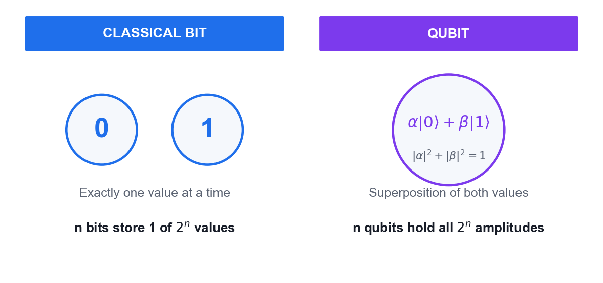
*A classical bit versus a qubit — the object your linear algebra describes.*

**What you'll build**

A Python notebook that verifies unitarity and Hermiticity, computes eigenvalues/eigenvectors, and builds two-qubit states with the tensor product.   (Tools: Python 3.13, NumPy, Google Colab / VS Code.)

**Step-by-step**

1. Open Google Colab (or VS Code) and create a new Python notebook for this lab.
2. Import NumPy and define the computational basis states |0> = [1,0] and |1> = [0,1] as column vectors.

   ```python
   import numpy as np
   ket0 = np.array([[1],[0]]); ket1 = np.array([[0],[1]])
   ```

3. Build a normalised superposition state |+> = (|0> + |1>)/sqrt(2) and confirm its norm is 1.

   ```python
   plus = (ket0 + ket1)/np.sqrt(2)
   print(np.linalg.norm(plus))   # 1.0
   ```

4. Define the Pauli-X, Pauli-Y, Pauli-Z and Hadamard matrices as NumPy arrays.

   ```python
   X = np.array([[0,1],[1,0]]); Z = np.array([[1,0],[0,-1]])
   H = (1/np.sqrt(2))*np.array([[1,1],[1,-1]])
   ```

5. Verify that H is unitary by checking that H-dagger times H equals the identity.

   ```python
   print(np.allclose(H.conj().T @ H, np.eye(2)))   # True
   ```

6. Verify that X and Z are Hermitian by checking that A-dagger equals A, then confirm their eigenvalues are real.

   ```python
   print(np.allclose(X.conj().T, X))
   print(np.linalg.eigvals(X))   # [1., -1.]
   ```

7. Compute the eigenvalues and eigenvectors of the Pauli-Z operator and interpret them as measurement outcomes.

   ```python
   vals, vecs = np.linalg.eig(Z)
   print(vals); print(vecs)
   ```

8. Compute the inner product <0|+> and apply the Born rule to obtain the probability of measuring 0.

   ```python
   amp = (ket0.conj().T @ plus).item()
   print(abs(amp)**2)   # 0.5
   ```

9. Build the two-qubit state |0> tensor |1> using the Kronecker product and confirm it has 4 components.

   ```python
   psi = np.kron(ket0, ket1)
   print(psi.T, psi.shape)   # (4, 1)
   ```

10. Build the two-qubit operator H tensor I and verify that it is also unitary.

   ```python
   HI = np.kron(H, np.eye(2))
   print(np.allclose(HI.conj().T @ HI, np.eye(4)))
   ```


**Test it**

H-dagger H equals the identity, X and Z return real eigenvalues +1 and -1, the Born-rule probability of measuring 0 in |+> is 0.5, and the tensor product produces a 4-component two-qubit state.

> **Note:** The reference implementation for this activity is in labs/lab01/. Read the source before you run it — understanding the circuit matters more than the output.

---


## Topic 02 — Introduction to Quantum Computing Systems

Overview of quantum computers · Commercial systems · Superposition and Entanglement

**Key concepts**

- Qubit vs classical bit — A bit is 0 or 1; a qubit is α|0⟩ + β|1⟩ with |α|² + |β|² = 1, allowing superposition of both values.
- Bloch sphere — Every pure single-qubit state maps to a point on the unit sphere — the standard geometric picture of qubit state and rotation.
- Physical qubits — Superconducting (Josephson junction), trapped-ion and topological qubits trade off speed, coherence time and connectivity.
- Commercial platforms — IBM Quantum, Google, IonQ, Rigetti and D-Wave offer cloud access to real quantum processors today.
- Superposition — A quantum register of n qubits holds a superposition of all 2ⁿ basis states simultaneously — the source of quantum parallelism.
- Entanglement — Entangled states cannot be written as a product of single-qubit states; measuring one qubit instantly correlates with the other.


### Activity 2 — Visualising a Qubit on the Bloch Sphere

Learning outcome: LO2 — Decide on appropriate physical methodologies specific to quantum computing problems.

Goal: Build single-qubit states in Qiskit and plot them on the Bloch sphere, so you can see how gates rotate a qubit and what superposition and phase actually look like geometrically.

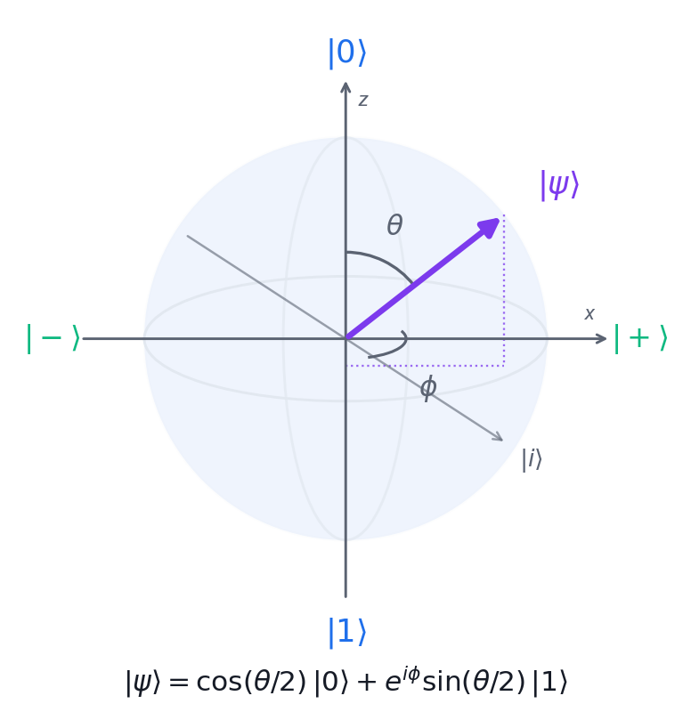
*The Bloch sphere: theta sets the measurement probability, phi sets the phase.*

**What you'll build**

A set of Bloch-sphere plots showing |0>, |1>, |+>, |-> and an arbitrary Ry-rotated state.   (Tools: Qiskit 2.x, matplotlib, Google Colab.)

**Step-by-step**

1. Install Qiskit with visualisation support in your Colab notebook or local environment.

   ```python
   pip install 'qiskit[visualization]' matplotlib pylatexenc
   ```

2. Import Statevector and plot_bloch_multivector from Qiskit.

   ```python
   from qiskit.quantum_info import Statevector
   from qiskit.visualization import plot_bloch_multivector
   ```

3. Create a one-qubit circuit left in the |0> state and plot it — the vector points to the north pole.

   ```python
   from qiskit import QuantumCircuit
   qc = QuantumCircuit(1)
   plot_bloch_multivector(Statevector(qc))
   ```

4. Apply an X gate to flip the qubit to |1> and re-plot — the vector now points to the south pole.

   ```python
   qc = QuantumCircuit(1); qc.x(0)
   plot_bloch_multivector(Statevector(qc))
   ```

5. Apply a Hadamard gate to reach the |+> state and observe the vector lying on the equator along +x.

   ```python
   qc = QuantumCircuit(1); qc.h(0)
   plot_bloch_multivector(Statevector(qc))
   ```

6. Apply H then Z to reach |-> and confirm the vector points along -x.

   ```python
   qc = QuantumCircuit(1); qc.h(0); qc.z(0)
   plot_bloch_multivector(Statevector(qc))
   ```

7. Apply an Ry rotation of pi/4 to create an arbitrary superposition and read off its amplitudes.

   ```python
   import numpy as np
   qc = QuantumCircuit(1); qc.ry(np.pi/4, 0)
   print(Statevector(qc))
   ```

8. Apply an S gate after H and observe that a phase gate rotates the vector around the z-axis without changing measurement probabilities in the Z basis.

   ```python
   qc = QuantumCircuit(1); qc.h(0); qc.s(0)
   plot_bloch_multivector(Statevector(qc))
   ```

9. Record which gates move the vector between poles and which rotate it around the equator.

**Test it**

|0> sits at the north pole, X moves it to the south pole, H places it on the equator at +x, and the S gate rotates it around the equator while leaving the Z-basis probabilities at 50/50.

> **Note:** The reference implementation for this activity is in labs/lab02/. Read the source before you run it — understanding the circuit matters more than the output.

---


### Activity 3 — Superposition and Entanglement on IBM Quantum

Learning outcome: LO2, LO4 — Evaluate quantum computing applicability in the business context.

Goal: Create your IBM Quantum account, build a superposition circuit and a two-qubit Bell state, and run them on a real quantum processor to see genuine quantum randomness and correlation in the results.

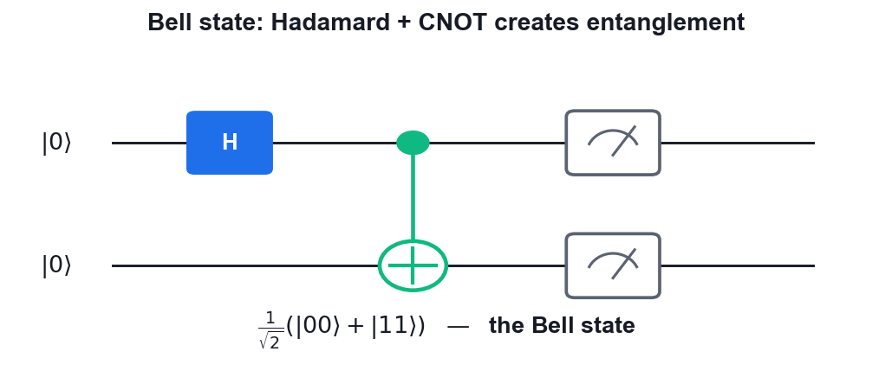
*The Bell state circuit you will build and run on IBM Quantum hardware.*

**What you'll build**

A Bell state circuit executed on real IBM Quantum hardware, with a measured histogram showing the |00> and |11> correlation.   (Tools: IBM Quantum Platform, Qiskit Runtime, Python 3.13.)

**Step-by-step**

1. Sign up for a free IBM Quantum account and copy your API token from the dashboard.

   ```python
   # https://quantum.ibm.com
   ```

2. Store the token and instance in a .env file in the labs folder so the scripts can authenticate.

   ```python
   IBM_QUANTUM_TOKEN=your_api_token_here
   IBM_QUANTUM_INSTANCE=your_instance_here
   ```

3. Install the Qiskit runtime packages in your environment.

   ```python
   pip install qiskit qiskit-ibm-runtime python-dotenv
   ```

4. Build a one-qubit superposition circuit with a Hadamard gate and a measurement.

   ```python
   from qiskit import QuantumCircuit
   qc = QuantumCircuit(1,1); qc.h(0); qc.measure(0,0)
   ```

5. Build the Bell state circuit: Hadamard on qubit 0, then CNOT from qubit 0 to qubit 1.

   ```python
   bell = QuantumCircuit(2,2)
   bell.h(0); bell.cx(0,1); bell.measure([0,1],[0,1])
   ```

6. Connect to IBM Quantum and select the least busy real backend with at least 2 qubits.

   ```python
   from qiskit_ibm_runtime import QiskitRuntimeService
   service = QiskitRuntimeService()
   backend = service.least_busy(operational=True, simulator=False, min_num_qubits=2)
   ```

7. Transpile the Bell circuit for the chosen backend so it uses only that device's native gates.

   ```python
   from qiskit import transpile
   tqc = transpile(bell, backend, optimization_level=1)
   ```

8. Submit the job with the SamplerV2 primitive using 1024 shots and wait for the result.

   ```python
   from qiskit_ibm_runtime import SamplerV2 as Sampler
   job = Sampler(mode=backend).run([tqc], shots=1024)
   print(job.job_id())
   ```

9. Plot the measurement histogram and compare it against the ideal 50/50 split.

   ```python
   from qiskit.visualization import plot_histogram
   ```

10. Explain why a small number of |01> and |10> counts appear on real hardware but never in the ideal simulation.

**Test it**

The superposition circuit gives roughly 50% |0> and 50% |1>; the Bell circuit gives roughly 50% |00> and 50% |11> with only a small percentage of |01> and |10> counts caused by hardware noise.

> **Note:** The reference implementation for this activity is in labs/lab03/. Read the source before you run it — understanding the circuit matters more than the output.

---


## Topic 03 — Quantum Gates and Circuits

Single Qubit Gates · Multi Qubit Gates · Bell and GHZ States · Phase Kickback

**Key concepts**

- Pauli gates — X (bit flip), Y and Z (phase flip) are self-inverse, Hermitian and unitary — the building blocks of single-qubit logic.
- Hadamard gate — H maps |0⟩ → |+⟩ and |1⟩ → |−⟩, creating the equal superposition that starts nearly every quantum algorithm.
- Rotation and phase gates — Rx, Ry, Rz rotate the Bloch vector; S and T are special cases of the phase gate P(θ).
- Multi-qubit gates — CNOT, CZ, controlled-phase, SWAP and Toffoli (CCNOT) create the entanglement that makes quantum computing powerful.
- Bell and GHZ states — H followed by CNOT produces a maximally entangled Bell pair; extending to n qubits gives the GHZ state.
- Phase kickback — A controlled operation on an eigenstate transfers the eigenvalue phase back to the control qubit — the engine of Deutsch, BV and QPE.


### Proof — Phase Kickback

**Claim**

A controlled-U acting on an EIGENSTATE of U leaves the target unchanged and transfers the eigenvalue phase onto the CONTROL qubit.

**Given**

- U is a unitary operator with eigenvector |u> and eigenvalue e^(iθ):  U|u> = e^(iθ)|u>.
- The control qubit starts in |0>; the target starts in the eigenstate |u>.
- CU is the controlled-U gate: it applies U to the target only when the control is |1>.

**Step 1 — Put the control into superposition**

```bash
Start:            |0> (x) |u>
Apply H to the control qubit:
H|0> = (|0> + |1>)/√2
State:            (1/√2)( |0> + |1> ) (x) |u>
                = (1/√2)( |0>|u> + |1>|u> )
```

> **Note:** The control is now in an equal superposition; the target still holds the eigenstate.

**Step 2 — Apply the controlled-U**

```bash
CU acts term by term (linearity):
  CU |0>|u>  =  |0>|u>          (control is 0 -> do nothing)
  CU |1>|u>  =  |1> U|u>        (control is 1 -> apply U)
Now use the eigenvalue relation U|u> = e^(iθ)|u>:
  CU |1>|u>  =  |1> e^(iθ)|u>  =  e^(iθ) |1>|u>
```

> **Note:** The scalar e^(iθ) can be moved freely — it multiplies the WHOLE term.

**Step 3 — Collect the terms**

```bash
State:  (1/√2)( |0>|u>  +  e^(iθ) |1>|u> )
Factor the target |u> out of both terms:
        = (1/√2)( |0> + e^(iθ)|1> ) (x) |u>
```

> **Note:** This factorisation is the heart of the proof — the state is SEPARABLE again.

**Step 4 — Read off the result**

```bash
Target register:   |u>       —  UNCHANGED
Control register:  (|0> + e^(iθ)|1>)/√2

The phase e^(iθ), which belonged to the TARGET's eigenvalue,
now sits as a RELATIVE PHASE on the CONTROL qubit.
```

> **Note:** The information moved from the target to the control without the target changing.

**Step 5 — The oracle special case**

```bash
Take U = X (the NOT gate) and |u> = |-> = (|0> - |1>)/√2.
Check it is an eigenstate:   X|-> = (X|0> - X|1>)/√2
                                  = (|1> - |0>)/√2
                                  = -(|0> - |1>)/√2  =  (-1)|->
So |-> is an eigenvector of X with eigenvalue -1, i.e. e^(iπ).

For an oracle U_f: |x>|y> -> |x>|y ⊕ f(x)>, setting the target to |->:
   U_f |x>|->  =  (-1)^f(x) |x>|->
```

> **Note:** This is THE identity that powers Deutsch, Deutsch-Jozsa, Bernstein-Vazirani, Grover's oracle and quantum phase estimation.

**Result**

Controlled-U on an eigenstate |u> gives (|0> + e^(iθ)|1>)/√2 (x) |u> — the eigenvalue phase is 'kicked back' onto the control. With U = X and target |->, the oracle marks inputs with the sign (-1)^f(x).

**Why it matters**

Measurement cannot see a GLOBAL phase, but a RELATIVE phase on the control is converted into a measurable amplitude by a final Hadamard. Phase kickback is how a quantum computer extracts a global property of f without evaluating f at every input.

---


### Activity 4 — Building Circuits in IBM Quantum Composer

Learning outcome: LO5 — Spearhead the application of quantum gates to quantum computing domains.

Goal: Use the drag-and-drop IBM Quantum Composer to build single- and multi-qubit circuits, watch the state vector and probability panels update live, and export the circuit as OpenQASM.

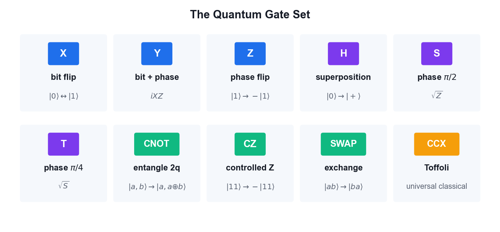
*The gate palette available in IBM Quantum Composer.*

**What you'll build**

A set of Composer circuits (X, H, CNOT, Bell state) with their statevector output, exported as OpenQASM 3 code.   (Tools: IBM Quantum Composer, OpenQASM 3.)

**Step-by-step**

1. Open IBM Quantum Composer in your browser and sign in with your IBM Quantum account.

   ```python
   # https://quantum.ibm.com/composer
   ```

2. Create a new circuit with 2 qubits and open the Statevector and Probabilities visualisation panels.
3. Drag an X gate onto qubit 0 and observe the state change from |00> to |01> in the probability panel.
4. Remove the X gate, drag a Hadamard gate onto qubit 0 and observe the equal superposition appear.
5. Add a CNOT gate with qubit 0 as control and qubit 1 as target to create the Bell state.
6. Confirm the probability panel shows only |00> and |11> at 50% each — the signature of entanglement.
7. Switch to the OpenQASM view and copy the generated code for your circuit.

   ```python
   OPENQASM 3;
   include "stdgates.inc";
   qubit[2] q;
   h q[0];
   cx q[0], q[1];
   ```

8. Load the provided bell-state QASM file from the labs folder into Composer and confirm it reproduces the same circuit.
9. Experiment with Z, S and T gates after the Hadamard and note which ones change the probability panel and which only change the phase.

**Test it**

The Composer probability panel shows a 50/50 split between |00> and |11> for the Bell circuit, and the exported OpenQASM contains an h instruction followed by a cx instruction.

> **Note:** The reference implementation for this activity is in labs/lab04/. Read the source before you run it — understanding the circuit matters more than the output.

---


### Activity 5 — Quantum Gates and Bell/GHZ States with PennyLane

Learning outcome: LO3, LO5 — Direct two-level quantum models and apply quantum gates.

Goal: Use PennyLane's quantum-function and QNode model to apply the full single- and multi-qubit gate set, then construct Bell and GHZ entangled states and verify their measurement correlations.


*Hadamard followed by CNOT — the Bell state you build in PennyLane.*

**What you'll build**

A PennyLane script that draws each circuit, returns the state vector, and confirms the Bell and GHZ correlations.   (Tools: PennyLane, Python 3.13, matplotlib.)

**Step-by-step**

1. Install PennyLane in your environment.

   ```python
   pip install pennylane
   ```

2. Create a 2-qubit default.qubit device to run your circuits on.

   ```python
   import pennylane as qml
   dev = qml.device('default.qubit', wires=2)
   ```

3. Write a quantum function that applies a Pauli-X to wire 0 and returns the state, then wrap it in a QNode.

   ```python
   @qml.qnode(dev)
   def circuit():
       qml.PauliX(0)
       return qml.state()
   ```

4. Print the circuit diagram using PennyLane's draw function to confirm the gate placement.

   ```python
   print(qml.draw(circuit)())
   ```

5. Build the Bell state by applying a Hadamard to wire 0 followed by a CNOT from wire 0 to wire 1.

   ```python
   @qml.qnode(dev)
   def bell():
       qml.Hadamard(0); qml.CNOT([0,1])
       return qml.state()
   ```

6. Print the resulting state vector and confirm the amplitudes are 0.707 on |00> and |11> only.

   ```python
   print(bell())   # [0.707, 0, 0, 0.707]
   ```

7. Change the device to 3 wires and build the GHZ state with a Hadamard and two CNOT gates.

   ```python
   dev3 = qml.device('default.qubit', wires=3)
   @qml.qnode(dev3)
   def ghz():
       qml.Hadamard(0); qml.CNOT([0,1]); qml.CNOT([1,2])
       return qml.state()
   ```

8. Verify the GHZ state has amplitude only on |000> and |111>.

   ```python
   print(ghz())
   ```

9. Replace the state return with qml.probs to obtain measurement probabilities instead of amplitudes.

   ```python
   return qml.probs(wires=[0,1])
   ```

10. Demonstrate phase kickback: apply a controlled-Z with the target in the |-> eigenstate and observe the phase appear on the control qubit.

**Test it**

The Bell state returns amplitudes of about 0.707 on |00> and |11> and zero elsewhere; the GHZ state returns amplitudes only on |000> and |111>; the phase-kickback circuit shows the eigenvalue phase transferred to the control qubit.

> **Note:** The reference implementation for this activity is in labs/lab05/. Read the source before you run it — understanding the circuit matters more than the output.

---


## Topic 04 — Quantum Protocols

No-Cloning Theorem · Teleportation · Superdense Coding · BB84 QKD · CHSH Game

**Key concepts**

- No-cloning theorem — No unitary can copy an arbitrary unknown quantum state — proved by linearity, and the foundation of quantum key security.
- Quantum teleportation — Transfers an unknown qubit state using one shared Bell pair plus two classical bits — no faster-than-light signalling.
- Superdense coding — The dual of teleportation: send two classical bits by transmitting a single qubit of a pre-shared entangled pair.
- BB84 QKD — Alice and Bob build a shared secret key using random bases; eavesdropping disturbs the states and raises the error rate.
- Eavesdropping detection — An intercept-resend attack introduces roughly a 25% error rate in the sifted key, revealing Eve's presence.
- CHSH game — A quantum strategy using entanglement wins ~85% of the time versus the classical maximum of 75%, disproving local hidden variables.


### Proof — Quantum Teleportation

**Claim**

An unknown qubit state can be transferred using one shared Bell pair and two classical bits — without ever measuring or copying the state itself.

**Given**

- Alice holds an unknown qubit  |ψ> = a|0> + b|1>,  with |a|² + |b|² = 1.
- Alice and Bob share the Bell pair  |Φ+> = (|00> + |11>)/√2.
- Qubit ordering:  q0 = Alice's unknown state, q1 = Alice's half, q2 = Bob's half.
- Neither party knows a or b — and neither learns them at any point.

**Step 1 — Write the full three-qubit state**

```bash
|Ψ₀>  =  |ψ>₀ (x) |Φ+>₁₂
      =  (a|0> + b|1>) (x) (|00> + |11>)/√2

Expand:
      =  (1/√2)( a|000> + a|011> + b|100> + b|111> )
```

> **Note:** Three qubits, so the state space has 2³ = 8 dimensions; four terms are populated.

**Step 2 — Alice applies CNOT (q0 -> q1)**

```bash
CNOT flips q1 when q0 = 1. Term by term:
   a|000> -> a|000>       (q0=0, unchanged)
   a|011> -> a|011>       (q0=0, unchanged)
   b|100> -> b|110>       (q0=1, flip q1)
   b|111> -> b|101>       (q0=1, flip q1)

|Ψ₁> = (1/√2)( a|000> + a|011> + b|110> + b|101> )
```

> **Note:** This begins Alice's Bell-basis measurement — CNOT then H rotates the Bell basis into the computational basis.

**Step 3 — Alice applies H to q0**

```bash
H|0> = (|0>+|1>)/√2 ,  H|1> = (|0>-|1>)/√2. Substituting:

|Ψ₂> = (1/2)[ a(|0>+|1>)|00> + a(|0>+|1>)|11>
            + b(|0>-|1>)|10> + b(|0>-|1>)|01> ]
```

> **Note:** Now expand and regroup by Alice's two qubits (q0 q1) — the next step.

**Step 4 — Regroup by Alice's measurement outcome**

```bash
Collecting terms with the same q0q1 prefix:

|Ψ₂> = (1/2) [  |00>(a|0> + b|1>)
              + |01>(a|1> + b|0>)
              + |10>(a|0> - b|1>)
              + |11>(a|1> - b|0>) ]
```

> **Note:** THIS IS THE KEY LINE. Bob's qubit is already |ψ> up to a known correction, in every branch.

**Step 5 — Alice measures; Bob's state collapses**

```bash
Each outcome has probability |1/2|² = 1/4 — independent of a and b.

   00  ->  Bob has  a|0> + b|1>   =  |ψ>
   01  ->  Bob has  a|1> + b|0>   =  X|ψ>
   10  ->  Bob has  a|0> - b|1>   =  Z|ψ>
   11  ->  Bob has  a|1> - b|0>   =  XZ|ψ> (up to phase)
```

> **Note:** Because every outcome is equally likely REGARDLESS of a and b, Alice's measurement reveals nothing about the state — this is why no information leaks.

**Step 6 — Bob applies the correction**

```bash
Alice sends the two classical bits (b₀b₁). Bob applies:

   00  ->  I    (do nothing)         ->  |ψ>
   01  ->  X                          ->  X·X|ψ>  = |ψ>
   10  ->  Z                          ->  Z·Z|ψ>  = |ψ>
   11  ->  ZX                         ->            |ψ>

using X² = Z² = I.
```

> **Note:** In every branch Bob ends holding exactly a|0> + b|1>.

**Step 7 — Consistency checks**

```bash
NO CLONING
   Alice's q0 was measured, so her copy is destroyed.
   Only ONE |ψ> exists at the end — no cloning occurred.

NO FASTER-THAN-LIGHT SIGNALLING
   Before the classical bits arrive, Bob's qubit is the maximally
   mixed state ρ = I/2 — it carries no information at all.
   The two classical bits travel at or below light speed.

NO STATE KNOWLEDGE
   Neither party ever learns the amplitudes a or b.
```

> **Note:** Teleportation respects both quantum and relativistic limits.

**Result**

Bob's qubit is exactly |ψ> = a|0> + b|1> after applying the correction indicated by Alice's two classical bits. The original was destroyed by the measurement.

**Why it matters**

Teleportation is the foundation of quantum networking and the quantum internet, and is used inside fault-tolerant architectures to move logical qubits between code blocks. It shows entanglement + classical communication can substitute for sending a qubit.

---


### Proof — The No-Cloning Theorem

**Claim**

No unitary operation can copy an arbitrary unknown quantum state.

**Given**

- Suppose a cloning machine U exists with  U(|ψ>|0>) = |ψ>|ψ>  for EVERY state |ψ>.
- |0> is a blank slate; |ψ> is the state to copy.
- We derive a contradiction — this is a proof by contradiction.

**Step 1 — Assume two arbitrary states**

```bash
Let |ψ> and |φ> be any two states. By assumption:

   U(|ψ>|0>)  =  |ψ>|ψ>
   U(|φ>|0>)  =  |φ>|φ>
```

> **Note:** No restriction yet — this is just the definition of a universal cloner.

**Step 2 — Unitary preserves inner products**

```bash
For any unitary U:   <Uα|Uβ> = <α|U†U|β> = <α|I|β> = <α|β>

Apply this to our two inputs:
   LHS  =  <ψ|φ> · <0|0>  =  <ψ|φ>
   RHS  =  <ψ|φ> · <ψ|φ>  =  <ψ|φ>²
```

> **Note:** Unitarity is the only physical assumption used — this is why the theorem is so general.

**Step 3 — Solve the resulting equation**

```bash
Setting LHS = RHS and writing z = <ψ|φ>:

        z  =  z²
   z² - z  =  0
   z(z - 1) =  0

So either  z = 0  or  z = 1.
```

> **Note:** Only two possibilities survive.

**Step 4 — Interpret the two solutions**

```bash
z = <ψ|φ> = 1  =>  |ψ> and |φ> are the SAME state.
z = <ψ|φ> = 0  =>  |ψ> and |φ> are ORTHOGONAL.

But we assumed U clones ARBITRARY states — including states that are
neither identical nor orthogonal, e.g. |0> and |+>, where <0|+> = 1/√2.

1/√2 is neither 0 nor 1  ->  CONTRADICTION.
```

> **Note:** The assumption fails for any pair of non-orthogonal, non-identical states.

**Step 5 — Conclusion**

```bash
No unitary can clone an arbitrary unknown state.

What IS possible:
  • copying states known to be from an ORTHOGONAL set (classical copying)
  • MOVING a state (teleportation — the original is destroyed)
  • approximate cloning with bounded fidelity (max ~5/6 for a universal cloner)
```

> **Note:** Note the theorem forbids perfect copying of UNKNOWN states — classical bits, which are always in an orthogonal set, remain copyable.

**Result**

Perfect cloning of an arbitrary unknown quantum state is impossible — it would violate the linearity/unitarity of quantum mechanics.

**Why it matters**

No-cloning is the security foundation of QKD: an eavesdropper cannot copy the qubits in transit and must instead measure them, which disturbs the state and reveals her presence. It is also why quantum error correction cannot work by simple redundancy.

---


### Proof — BB84 Security and Eavesdropper Detection

**Claim**

An intercept-resend eavesdropper introduces a 25% error rate in the sifted key and is therefore detected with near-certainty.

**Given**

- Two conjugate bases:  Z = {|0>, |1>}  and  X = {|+>, |->}.
- Encoding:  bit 0 -> |0> or |+> ;  bit 1 -> |1> or |->  (basis chosen at random).
- The bases are UNBIASED: |<0|+>|² = |<0|->|² = |<1|+>|² = |<1|->|² = 1/2.
- Alice and Bob each choose their basis independently and uniformly at random.

**Step 1 — Sifting (no eavesdropper)**

```bash
Alice sends n qubits. Bob measures each in a random basis.

P(bases match) = 1/2, so about n/2 qubits survive sifting.

When the bases MATCH, Bob's measurement is deterministic:
   Alice sends |0> in Z, Bob measures Z  ->  gets 0 with probability 1
So the sifted key agrees perfectly (up to channel noise).
```

> **Note:** The bits where the bases differed are publicly discarded — they carry no key.

**Step 2 — Eve intercepts and resends**

```bash
Eve does not know Alice's basis, so she guesses:
   P(Eve picks the right basis) = 1/2

CASE 1 — Eve guesses RIGHT (prob 1/2):
   She measures correctly, resends the same state.
   Bob (same basis as Alice) gets the right bit. NO error introduced.
```

> **Note:** Half the time Eve is invisible on that qubit.

**Step 3 — Eve guesses the WRONG basis**

```bash
CASE 2 — Eve guesses WRONG (prob 1/2):

Say Alice sent |0> (Z basis) but Eve measures in X.
   |0> = (|+> + |->)/√2
   Eve gets |+> or |-> with probability 1/2 each — and RESENDS that.

Bob now measures in Z (matching Alice). Say Eve resent |+>:
   |+> = (|0> + |1>)/√2
   Bob gets 0 or 1 with probability 1/2 each.
   -> Bob's bit is WRONG with probability 1/2.
```

> **Note:** Eve's wrong-basis measurement has destroyed the original state. She cannot restore it — that is the no-cloning theorem doing the work.

**Step 4 — Compute the total error rate**

```bash
P(error) = P(Eve wrong basis) × P(Bob then errs)
         = 1/2 × 1/2
         = 1/4  =  25%

So on the sifted key, roughly 1 bit in 4 disagrees between Alice and Bob.
```

> **Note:** This 25% figure — the Quantum Bit Error Rate (QBER) — is the signature of intercept-resend.

**Step 5 — Detection probability**

```bash
Alice and Bob publicly compare a random sample of m sifted bits.

P(a given compared bit fails to reveal Eve) = 1 - 1/4 = 3/4
P(Eve escapes detection over m bits)        = (3/4)^m

   m = 10   ->  5.6% escape chance
   m = 50   ->  0.000006%
   m = 100  ->  ~3 × 10⁻¹³
```

> **Note:** Detection probability rises exponentially with the size of the test sample.

**Step 6 — Decision rule and post-processing**

```bash
Alice and Bob measure the QBER on the test sample:

   QBER below threshold (~11%)  ->  proceed:
        • error correction (reconcile the remaining differences)
        • privacy amplification (hash down to a shorter, secure key)
   QBER above threshold          ->  ABORT and discard the key

The discarded test bits are never reused as key material.
```

> **Note:** Real systems tolerate a few percent QBER from hardware noise; the threshold separates tolerable noise from an active attack.

**Result**

Intercept-resend produces a 25% QBER. Comparing 100 random sifted bits detects Eve with probability 1 - (3/4)¹⁰⁰ ≈ 1 - 3×10⁻¹³.

**Why it matters**

BB84's security rests on PHYSICS (no-cloning + measurement disturbance), not on a computational hardness assumption. A quantum computer does not weaken it — unlike RSA and ECC, which Shor's algorithm breaks outright.

---


### Proof — The CHSH Inequality and Bell Violation

**Claim**

Local hidden-variable theories obey |S| ≤ 2, but quantum mechanics reaches 2√2 ≈ 2.828.

**Given**

- Alice measures A₀ or A₁; Bob measures B₀ or B₁. Each outcome is ±1.
- The CHSH quantity:  S = <A₀B₀> + <A₀B₁> + <A₁B₀> - <A₁B₁>.
- LOCAL REALISM assumes each measurement has a definite pre-existing value.

**Step 1 — The classical bound**

```bash
Under local realism every a₀,a₁,b₀,b₁ ∈ {+1,-1} exists simultaneously.

   S = a₀b₀ + a₀b₁ + a₁b₀ - a₁b₁
     = a₀(b₀ + b₁) + a₁(b₀ - b₁)

Since b₀,b₁ = ±1, one of (b₀+b₁), (b₀-b₁) is 0 and the other is ±2.
So S = ±2 in every case, hence  |S| ≤ 2.
```

> **Note:** This is the CHSH inequality. It assumes ONLY locality and realism — no physics beyond that.

**Step 2 — The quantum prediction**

```bash
Take the singlet  |Ψ-> = (|01> - |10>)/√2.
For measurement directions a and b, quantum mechanics predicts:

   <A(a)B(b)>  =  -cos(θ_ab)

where θ_ab is the angle between the two measurement axes.
```

> **Note:** This correlation is derived from the Born rule alone.

**Step 3 — Choose the optimal angles**

```bash
Pick A₀ = 0°, A₁ = 45°, B₀ = 22.5°, B₁ = 67.5°. Then:

   <A₀B₀> = -cos(22.5°) = -0.9239
   <A₀B₁> = -cos(67.5°) = -0.3827
   <A₁B₀> = -cos(22.5°) = -0.9239
   <A₁B₁> = -cos(22.5°) = -0.9239   (angle 22.5° the other way)

   |S| = |−0.9239 − 0.3827 − 0.9239 + 0.9239| … = 2√2 ≈ 2.828
```

> **Note:** 2√2 is the Tsirelson bound — the maximum quantum mechanics allows.

**Step 4 — What the violation means**

```bash
   Classical (local realism):  |S| ≤ 2
   Quantum mechanics:          |S| = 2√2 ≈ 2.828
   Experiment (Aspect 1982, loophole-free 2015):  ~2.4-2.8

Nature VIOLATES the classical bound. Therefore no local hidden-variable
theory can reproduce quantum mechanics.

2022 Nobel Prize: Aspect, Clauser and Zeilinger.
```

> **Note:** Entanglement is not 'hidden classical correlation' — it is a genuinely non-classical resource.

**Result**

Local hidden variables force |S| ≤ 2; entangled qubits achieve 2√2. Experiments confirm the quantum value, ruling out local realism.

**Why it matters**

The CHSH violation is the basis of DEVICE-INDEPENDENT cryptography: if your devices violate the inequality, entanglement is genuine and a key can be certified secure even with untrusted hardware. It also underpins the E91 QKD protocol.

---


### Proof — Superdense Coding

**Claim**

One qubit of a pre-shared entangled pair carries TWO classical bits.

**Given**

- Alice and Bob share  |Φ+> = (|00> + |11>)/√2  in advance.
- Alice wants to send a 2-bit message; she may transmit only ONE qubit.
- The four Bell states form an orthonormal basis of the 2-qubit space.

**Step 1 — Alice encodes with a local operation**

```bash
Alice applies one gate to HER qubit only:

   message 00 -> I   ->  (|00> + |11>)/√2  =  |Φ+>
   message 01 -> X   ->  (|10> + |01>)/√2  =  |Ψ+>
   message 10 -> Z   ->  (|00> - |11>)/√2  =  |Φ->
   message 11 -> ZX  ->  (|10> - |01>)/√2  =  |Ψ->
```

> **Note:** Alice never touches Bob's qubit — yet the GLOBAL state changes, because the pair is entangled.

**Step 2 — The four results are orthogonal**

```bash
<Φ+|Φ-> = 0,  <Φ+|Ψ+> = 0,  <Φ+|Ψ-> = 0,  and so on.

All four Bell states are mutually ORTHOGONAL, so they can be
distinguished perfectly by a single measurement in the Bell basis.
```

> **Note:** Orthogonality is exactly what makes perfect discrimination possible — contrast with BB84, where non-orthogonal states protect the key.

**Step 3 — Bob decodes**

```bash
Alice sends her single qubit to Bob. He now holds both and undoes the
entangling circuit:

   CNOT (control = Alice's qubit, target = Bob's), then H on Alice's qubit

   |Φ+> -> |00>     |Ψ+> -> |01>
   |Φ-> -> |10>     |Ψ-> -> |11>

Bob measures both qubits and reads the 2-bit message.
```

> **Note:** The Bell measurement maps the four Bell states back to the computational basis.

**Step 4 — Accounting and limits**

```bash
Total qubits transmitted: 1.   Classical bits delivered: 2.

This does NOT violate Holevo's bound: the entangled pair had to be
distributed in advance, which itself required sending a qubit.

Superdense coding is the DUAL of teleportation:
   teleportation:      2 classical bits + 1 ebit  ->  1 qubit
   superdense coding:  1 qubit + 1 ebit           ->  2 classical bits
```

> **Note:** Entanglement is a RESOURCE that can be traded against communication.

**Result**

Alice transmits two classical bits by sending a single qubit, using a pre-shared entangled pair and a local Pauli operation.

**Why it matters**

Superdense coding proved entanglement has quantitative communication value, launching quantum information theory as a discipline and motivating entanglement-distribution networks.

---


### Activity 6 — Quantum Teleportation

Learning outcome: LO3, LO7 — Synthesize quantum methodologies to address complex problems.

Goal: Implement the three-qubit teleportation protocol: entangle a shared pair, perform a Bell measurement on the unknown state, and apply the conditional corrections that recreate the original state on Bob's qubit.

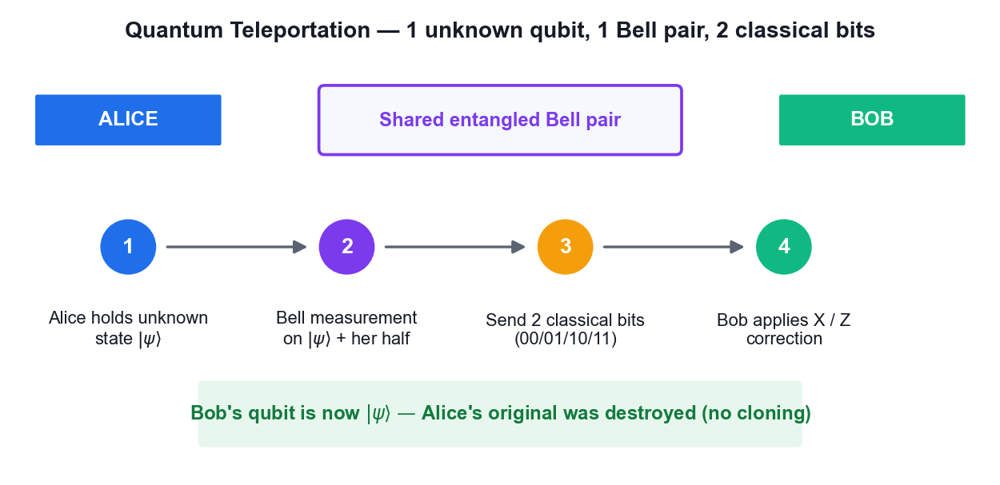
*The four stages of the quantum teleportation protocol.*

**What you'll build**

A teleportation circuit run on IBM Quantum hardware that reconstructs an arbitrary input state at the receiving qubit.   (Tools: Qiskit 2.x, IBM Quantum Runtime, OpenQASM.)

**Step-by-step**

1. Open the lab06 folder and review main.py before running it.

   ```python
   cd labs/lab06 && cat main.py
   ```

2. Create a 3-qubit circuit: q0 carries the state to teleport, q1 and q2 form the entangled pair.

   ```python
   from qiskit import QuantumCircuit
   qc = QuantumCircuit(3, 3)
   ```

3. Prepare an arbitrary state on q0 using a rotation so you have something non-trivial to teleport.

   ```python
   import numpy as np
   qc.ry(np.pi/4, 0)
   ```

4. Create the Bell pair between q1 and q2 with a Hadamard and a CNOT.

   ```python
   qc.h(1); qc.cx(1, 2)
   ```

5. Perform Alice's Bell measurement: CNOT from q0 to q1, then a Hadamard on q0.

   ```python
   qc.cx(0, 1); qc.h(0)
   ```

6. Measure q0 and q1 into the classical register — these are the two classical bits sent to Bob.

   ```python
   qc.measure([0, 1], [0, 1])
   ```

7. Apply Bob's conditional corrections: an X gate if bit 1 is set and a Z gate if bit 0 is set.

   ```python
   with qc.if_test((1, 1)): qc.x(2)
   with qc.if_test((0, 1)): qc.z(2)
   ```

8. Measure q2 and run the circuit on the least busy IBM Quantum backend.

   ```python
   python labs/lab06/main.py
   ```

9. Compare the measured distribution on q2 against the original state prepared on q0.
10. Explain why teleportation does not violate the no-cloning theorem — the original state is destroyed by the Bell measurement.

**Test it**

The measurement statistics on Bob's qubit q2 match the amplitudes of the state originally prepared on q0, within hardware noise, and the original state no longer exists on q0.

> **Note:** The reference implementation for this activity is in labs/lab06/. Read the source before you run it — understanding the circuit matters more than the output.

---


### Activity 7 — Superdense Coding Protocol

Learning outcome: LO3, LO7 — Direct two-level quantum models for quantum computing.

Goal: Implement the dual of teleportation: transmit two classical bits by sending only a single qubit of a pre-shared entangled pair, encoding the message with the I, X, Z and XZ operations.


*Superdense coding starts from the same shared Bell pair.*

**What you'll build**

A superdense coding circuit that correctly transmits all four two-bit messages 00, 01, 10 and 11.   (Tools: Qiskit 2.x, IBM Quantum Runtime.)

**Step-by-step**

1. Open the lab07 folder and review the encoding table in main.py.

   ```python
   cd labs/lab07 && cat main.py
   ```

2. Create a 2-qubit circuit and build the shared Bell pair with a Hadamard and CNOT.

   ```python
   qc = QuantumCircuit(2, 2)
   qc.h(0); qc.cx(0, 1)
   ```

3. Encode the message 00 by applying the identity — that is, doing nothing to Alice's qubit.
4. Encode the message 01 by applying an X gate to Alice's qubit.

   ```python
   qc.x(0)
   ```

5. Encode the message 10 by applying a Z gate to Alice's qubit.

   ```python
   qc.z(0)
   ```

6. Encode the message 11 by applying both Z and X to Alice's qubit.

   ```python
   qc.z(0); qc.x(0)
   ```

7. Decode by reversing the entangling operation: CNOT then Hadamard, and measure both qubits.

   ```python
   qc.cx(0, 1); qc.h(0)
   qc.measure([0,1],[0,1])
   ```

8. Run all four encodings on IBM Quantum hardware and record the measured bit strings.

   ```python
   python labs/lab07/main.py
   ```

9. Confirm each encoding decodes to its intended two-bit message with high probability.

**Test it**

Each of the four encodings decodes to its intended message — identity gives 00, X gives 01, Z gives 10 and ZX gives 11 — demonstrating two classical bits carried by one transmitted qubit.

> **Note:** The reference implementation for this activity is in labs/lab07/. Read the source before you run it — understanding the circuit matters more than the output.

---


### Activity 8 — BB84 Quantum Key Distribution with Eavesdropping Detection

Learning outcome: LO7 — Synthesize quantum methodologies to address complex problems.

Goal: Run the BB84 protocol end to end: random bit and basis selection, quantum transmission, basis sifting and key extraction — then repeat it with an eavesdropper present and measure the error rate that exposes the attack.

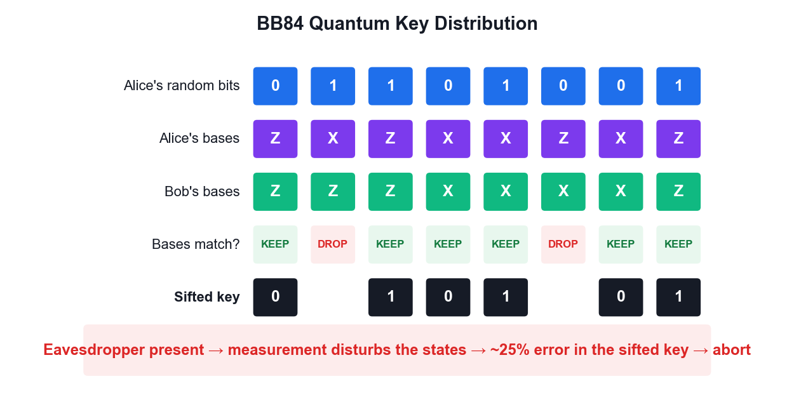
*BB84: basis sifting, and the error rate that exposes an eavesdropper.*

**What you'll build**

A working BB84 implementation producing a shared secret key, plus a comparison run showing the ~25% error rate introduced by an intercept-resend eavesdropper.   (Tools: Qiskit 2.x, IBM Quantum Runtime, Python.)

**Step-by-step**

1. Open the lab08 folder — it holds main.py (no eavesdropper) and main-with-eavesdropping.py.

   ```python
   ls labs/lab08
   ```

2. Review how Alice generates a random bit string and a random basis string for each qubit.

   ```python
   cat labs/lab08/main.py
   ```

3. Understand the encoding rule: in the Z basis send |0> or |1>; in the X basis send |+> or |->.
4. Note how Bob independently chooses a random measurement basis for each incoming qubit.
5. Run the protocol without an eavesdropper and observe the sifted key after basis reconciliation.

   ```python
   python labs/lab08/main.py
   ```

6. Confirm that where Alice and Bob used the same basis, their bits agree almost perfectly.
7. Now run the version with Eve performing an intercept-resend attack on the channel.

   ```python
   python labs/lab08/main-with-eavesdropping.py
   ```

8. Compare the error rate in the sifted key between the two runs.
9. Explain why Eve's measurement disturbs the state and produces roughly a 25% error rate in the sifted key.
10. Discuss how Alice and Bob decide to discard the key when the measured error rate exceeds their security threshold.

**Test it**

Without an eavesdropper the sifted key error rate is near zero (bounded only by hardware noise); with the intercept-resend eavesdropper the error rate rises to roughly 25%, which is the signal to abort and discard the key.

> **Note:** The reference implementation for this activity is in labs/lab08/. Read the source before you run it — understanding the circuit matters more than the output.

---


## Topic 05 — Quantum Algorithms

Deutsch · Deutsch-Jozsa · Bernstein-Vazirani · Grover · Quantum Fourier Transform

**Key concepts**

- The query (oracle) model — Algorithms are compared by how many times they query a black-box function — the standard measure of quantum advantage.
- Deutsch algorithm — Decides whether f:{0,1}→{0,1} is constant or balanced with ONE query; classically two are required.
- Deutsch-Jozsa — Extends the idea to n bits — one query versus 2ⁿ⁻¹+1 classical queries in the worst case: exponential separation.
- Bernstein-Vazirani — Recovers an n-bit hidden string s from f(x) = s·x (mod 2) in a single query instead of n.
- Grover search — Amplitude amplification finds a marked item in an unstructured database in O(√N) instead of O(N) — a quadratic speedup.
- Quantum Fourier Transform — The quantum analogue of the DFT runs in O(n²) gates and underpins phase estimation and Shor's algorithm.


### Quantum Phase Estimation

**The problem**

```bash
GIVEN:  a unitary U and one of its eigenvectors |u>, with

   U|u>  =  e^(2πiφ) |u>

FIND:   the phase φ ∈ [0,1), to n bits of precision.

Recall: unitary eigenvalues always have magnitude 1 (Axiom 2), so all
the information is in the single real number φ.
```

> **Note:** QPE is the workhorse subroutine: order finding, factoring, quantum chemistry energies and HHL all reduce to it.

**Step 1 — Superpose the counting register**

```bash
Use two registers:
   counting register:  t qubits, initialised |0>ᵗ
   eigenstate register: holds |u>

Apply H to every counting qubit:

   (1/√2ᵗ) Σ_(k=0..2ᵗ-1) |k>  (x)  |u>
```

> **Note:** t controls the precision: t bits give φ to t binary places.

**Step 2 — Controlled powers of U (kickback)**

```bash
Apply controlled-U^(2^j) from counting qubit j onto the eigenstate register.

By PHASE KICKBACK, since |u> is an eigenvector:

   C-U^(2^j) |1>|u>  =  e^(2πi 2^j φ) |1>|u>

Result over the whole register:
   (1/√2ᵗ) Σ_k  e^(2πi k φ) |k>  (x)  |u>
```

> **Note:** The eigenstate register is UNCHANGED throughout — every bit of the phase has been written onto the counting register. This is phase kickback at scale.

**Step 3 — Inverse QFT extracts the phase**

```bash
The counting register now holds  Σ_k e^(2πi kφ)|k>  — exactly the Fourier
transform of a peak at φ.

Apply the INVERSE QFT:

   QFT⁻¹ ( Σ_k e^(2πi kφ)|k> )   ->   |2ᵗ φ>

Measure the counting register: the result read as a binary fraction is φ.
```

> **Note:** If φ has an exact t-bit expansion the answer is exact; otherwise you get the best t-bit approximation with probability ≥ 4/π² ≈ 40%.

**Step 4 — Precision and cost**

```bash
To get φ to n bits with success probability 1-ε:

   t  =  n + ⌈log₂(2 + 1/(2ε))⌉   qubits

Cost is dominated by the controlled-U^(2^j) operations.

Worked example — U = Z, |u> = |1>:  Z|1> = -|1> = e^(2πi·0.5)|1>
   so φ = 0.5, and QPE returns binary 0.1 = 0.5. Verifiable by hand.
```

> **Note:** The Z example is the standard classroom check — small enough to trace through by hand, and it exercises the whole pipeline.

**Where QPE is used**

```bash
ORDER FINDING / SHOR — U: |y> -> |ay mod N>. The phase encodes the
   period r, so factoring reduces to QPE.

QUANTUM CHEMISTRY — U = e^(-iHt). The phase gives the ENERGY eigenvalue,
   the fault-tolerant successor to VQE.

HHL (linear systems) — QPE finds the eigenvalues of the matrix A so they
   can be inverted.

QUANTUM COUNTING — QPE applied to the Grover operator counts solutions.
```

> **Note:** If you understand phase kickback and the QFT, you understand the engine inside most of the exponentially-fast quantum algorithms.

---


### The Quantum Fourier Transform

**From the classical DFT**

```bash
The classical Discrete Fourier Transform maps a vector to its spectrum:

   y_k  =  (1/√N) Σ_(j=0..N-1)  x_j · e^(2πi jk/N)

The QFT is the SAME transform, applied to quantum AMPLITUDES:

   QFT |j>  =  (1/√N) Σ_(k=0..N-1) e^(2πi jk/N) |k>

and by linearity it acts on a whole superposition at once.
```

> **Note:** Same mathematics, different substrate: the DFT transforms data in memory, the QFT transforms amplitudes inside a superposition.

**Worked example — QFT on one qubit**

```bash
For n = 1, N = 2, and e^(2πi/2) = e^(iπ) = -1:

   QFT|0>  =  (|0> + |1>)/√2   =  |+>
   QFT|1>  =  (|0> - |1>)/√2   =  |->

That is exactly the HADAMARD gate.

   QFT₁  =  H
```

> **Note:** The Hadamard is the single-qubit QFT — a useful anchor for intuition.

**The circuit for n qubits**

```bash
For each qubit, in order:
   1. apply H
   2. apply controlled-phase rotations R_k from each lower qubit,
      where R_k adds the phase 2π/2^k
Finally, SWAP to reverse the qubit order.

3-qubit QFT:
   H(q2) · CP(π/2: q1->q2) · CP(π/4: q0->q2)
   H(q1) · CP(π/2: q0->q1)
   H(q0) · SWAP(q0,q2)
```

> **Note:** Each controlled rotation adds one further binary digit of phase precision.

**Cost and the honest caveat**

```bash
   QFT gate count:  O(n²)          on N = 2ⁿ amplitudes
   Classical FFT:   O(N log N)  =  O(n·2ⁿ)

Exponentially fewer operations — BUT:

   You cannot READ OUT the transformed amplitudes. Measuring gives ONE
   sample, not the spectrum. So the QFT does not accelerate signal
   processing; it accelerates finding a PERIOD or a PHASE.
```

> **Note:** State this caveat explicitly in class — it is the most commonly over-claimed result in quantum computing.

---


### Proof — The Deutsch Algorithm

**Claim**

One oracle query decides whether f:{0,1} -> {0,1} is CONSTANT or BALANCED. Any classical algorithm needs two.

**Given**

- f is a black box with f(0), f(1) in {0,1}.
- CONSTANT means f(0) = f(1);  BALANCED means f(0) ≠ f(1).
- The oracle is reversible:  U_f |x>|y> = |x>|y ⊕ f(x)>.
- Classically you must learn BOTH f(0) and f(1) — two queries — to compare them.

**Step 1 — Prepare the registers**

```bash
Start:                    |0> |1>
Apply H to both qubits:
  H|0> = |+> = (|0> + |1>)/√2
  H|1> = |-> = (|0> - |1>)/√2
State  |ψ₁> =  |+> |->
             =  (1/√2)( |0> + |1> ) (x) |->
```

> **Note:** The target is deliberately put in |-> so phase kickback will fire.

**Step 2 — Apply the oracle (phase kickback)**

```bash
By the kickback identity:   U_f |x>|->  =  (-1)^f(x) |x>|->
Apply it to each term of the superposition:

|ψ₂> = (1/√2)( (-1)^f(0)|0> + (-1)^f(1)|1> ) (x) |->
```

> **Note:** One query — but the oracle has acted on BOTH inputs at once. The target |-> is unchanged and now factors out entirely.

**Step 3 — Factor out the global phase**

```bash
Pull (-1)^f(0) out of the bracket:

|ψ₂> = (-1)^f(0) · (1/√2)( |0> + (-1)^(f(0) ⊕ f(1)) |1> ) (x) |->

(-1)^f(0) is a GLOBAL phase — unobservable, so we may drop it.
```

> **Note:** Everything now depends on the single bit f(0) ⊕ f(1) — exactly the question we are asking.

**Step 4 — Split into the two cases**

```bash
CASE A — f is CONSTANT:  f(0) = f(1)  =>  f(0) ⊕ f(1) = 0
   control = (|0> + |1>)/√2  =  |+>

CASE B — f is BALANCED:  f(0) ≠ f(1)  =>  f(0) ⊕ f(1) = 1
   control = (|0> - |1>)/√2  =  |->
```

> **Note:** The two cases are ORTHOGONAL states: <+|-> = 0. Orthogonal states can be distinguished perfectly by a single measurement.

**Step 5 — Interfere with a final Hadamard**

```bash
H is its own inverse and maps the |+>/|-> basis to the |0>/|1> basis:
   H|+> = |0>
   H|-> = |1>

CASE A (constant):  H|+> = |0>   -> measure 0 with probability 1
CASE B (balanced):  H|-> = |1>   -> measure 1 with probability 1
```

> **Note:** This is the interference step: a phase difference becomes an amplitude difference.

**Step 6 — Conclusion**

```bash
Measure the control qubit:

   result 0  =>  f is CONSTANT
   result 1  =>  f is BALANCED

Total oracle queries used: ONE.
Classical worst case: TWO.
```

> **Note:** The answer is deterministic — not probabilistic. No repetition is needed.

**Result**

Measuring 0 proves f is constant; measuring 1 proves f is balanced — with certainty, after a single oracle query.

**Why it matters**

Deutsch was the first proof that a quantum computer can beat every classical algorithm at a well-defined task. It answers a GLOBAL question (is f constant?) without learning the LOCAL values f(0) and f(1) — the template every later algorithm follows.

---


### Proof — Deutsch-Jozsa (n qubits)

**Claim**

For f:{0,1}ⁿ -> {0,1} PROMISED to be constant or balanced, one query decides which. Classically the worst case is 2^(n-1) + 1 queries.

**Given**

- Promise: f is either constant (same output for all 2ⁿ inputs) or balanced (exactly half the inputs give 0).
- Register: n input qubits in |0>ⁿ, plus one target qubit in |1>.

**Step 1 — Superposition over ALL 2ⁿ inputs**

```bash
Apply H to each of the n input qubits:

   Hⁿ |0>ⁿ  =  (1/√2ⁿ) Σ_x |x>        (sum over all x in {0,1}ⁿ)

Target: H|1> = |->
State:  (1/√2ⁿ) Σ_x |x> (x) |->
```

> **Note:** A single register now holds all 2ⁿ input strings simultaneously.

**Step 2 — Oracle applies the sign**

```bash
   U_f |x>|->  =  (-1)^f(x) |x>|->

State:  (1/√2ⁿ) Σ_x (-1)^f(x) |x>  (x) |->
```

> **Note:** ONE query has tagged every one of the 2ⁿ inputs with the sign of f(x).

**Step 3 — Final Hadamard layer**

```bash
The n-qubit Hadamard acts as:
   Hⁿ |x>  =  (1/√2ⁿ) Σ_z (-1)^(x·z) |z>      where x·z = Σ xᵢzᵢ mod 2

Applying it:
   (1/2ⁿ) Σ_z [ Σ_x (-1)^(f(x) + x·z) ] |z>
```

> **Note:** The bracket is the amplitude of outcome |z> — a sum of ±1 terms.

**Step 4 — Amplitude of the all-zeros outcome**

```bash
Set z = 0…0. Then x·z = 0 for every x, so:

   amplitude(|0…0>)  =  (1/2ⁿ) Σ_x (-1)^f(x)

CONSTANT: every term is the same sign, so the sum is ±2ⁿ
   amplitude = ±1   ->  probability |±1|² = 1

BALANCED: half the terms are +1 and half are -1, so the sum is 0
   amplitude = 0    ->  probability 0
```

> **Note:** Perfect constructive interference in one case, perfect destructive in the other.

**Step 5 — Conclusion**

```bash
Measure the n input qubits:

   all zeros (000…0)  =>  f is CONSTANT   (certainty)
   anything else      =>  f is BALANCED   (certainty)

Quantum: 1 query.   Classical worst case: 2^(n-1) + 1 queries.
```

> **Note:** For n = 20 that is 1 query versus 524,289 — an exponential separation.

**Result**

An all-zeros measurement proves f is constant; any other outcome proves f is balanced. One query, with certainty.

**Why it matters**

Deutsch-Jozsa gives the first EXPONENTIAL separation between quantum and classical query complexity. The pattern — superpose, kick back the phase, interfere — is the skeleton of Bernstein-Vazirani, Simon and ultimately Shor.

---


### Proof — Grover's Algorithm and the √N Speedup

**Claim**

Grover finds a marked item among N in O(√N) queries, and (π/4)√N iterations is optimal.

**Given**

- Search space of N = 2ⁿ items with exactly one marked item |w>.
- Oracle:  O|x> = -|x> if x = w, else O|x> = |x>   (a phase oracle).
- Classical search needs O(N) queries — on average N/2.

**Step 1 — Uniform superposition**

```bash
   |s>  =  Hⁿ|0>ⁿ  =  (1/√N) Σ_x |x>

Overlap with the marked item:   <w|s> = 1/√N
So P(measuring w now) = 1/N — no better than a random guess.
```

> **Note:** Superposition alone gives NO advantage. Interference must do the work.

**Step 2 — Work in a 2-D plane**

```bash
Define the state orthogonal to the marked item:
   |s'>  =  (1/√(N-1)) Σ_(x≠w) |x>

Then  |s> = sin(θ)|w> + cos(θ)|s'>   where  sin(θ) = 1/√N.

Everything that follows stays in the 2-D plane spanned by |w> and |s'>.
```

> **Note:** Reducing a 2ⁿ-dimensional problem to a 2-D rotation is the key simplification.

**Step 3 — The oracle is a reflection**

```bash
O flips the sign of the |w> component only:
   O( sin θ|w> + cos θ|s'> )  =  -sin θ|w> + cos θ|s'>

Geometrically: a REFLECTION about the |s'> axis.
```

> **Note:** The marked item is now 'marked' by a phase — still invisible to measurement.

**Step 4 — The diffuser is a second reflection**

```bash
   D  =  2|s><s| - I

This reflects any state about |s>. Equivalently: 'invert about the mean'.
Circuit:  Hⁿ · (2|0><0| - I) · Hⁿ
```

> **Note:** Two reflections in a plane compose to a ROTATION — that is the whole trick.

**Step 5 — Each Grover iteration rotates by 2θ**

```bash
Composing the two reflections:
   G = D·O  rotates the state by angle 2θ toward |w>.

After k iterations:
   |ψ_k>  =  sin((2k+1)θ)|w>  +  cos((2k+1)θ)|s'>

So  P(measure w)  =  sin²((2k+1)θ).
```

> **Note:** The amplitude on |w> grows roughly LINEARLY in k — while probability grows quadratically.

**Step 6 — Optimal number of iterations**

```bash
Maximise by setting (2k+1)θ = π/2:

   k  =  π/(4θ) - 1/2

For large N, sin θ = 1/√N gives θ ≈ 1/√N, so:

   k  ≈  (π/4)√N

Example N = 10⁶:  k ≈ 785 queries versus ~500,000 classically.
```

> **Note:** OVER-ROTATION IS REAL: run too many iterations and the state rotates PAST |w>, and the success probability falls again.

**Step 7 — Optimality**

```bash
Bennett, Bernstein, Brassard and Vazirani (1997) proved that ANY quantum
algorithm needs Ω(√N) queries for unstructured search.

Grover therefore achieves the optimal scaling — it cannot be improved.
```

> **Note:** The speedup is QUADRATIC, not exponential. This is why Grover only halves effective symmetric key lengths rather than breaking them.

**Result**

After ≈(π/4)√N iterations the marked state is measured with probability ≈1. The quadratic speedup is provably optimal for unstructured search.

**Why it matters**

Grover is the reason AES-128 drops to ~64-bit effective security against a quantum adversary and why NIST recommends AES-256. Its amplitude-amplification core also underpins quantum counting and amplitude estimation.

---


### Proof — The Quantum Fourier Transform is Efficient

**Claim**

The QFT on n qubits needs only O(n²) gates, versus O(N log N) = O(n·2ⁿ) for the classical FFT.

**Given**

- N = 2ⁿ. The QFT acts as  |j>  ->  (1/√N) Σ_k e^(2πi jk/N) |k>.
- ω = e^(2πi/N) is the primitive N-th root of unity.

**Step 1 — The product-form identity**

```bash
Write k in binary and expand the exponent. The 2ⁿ-term sum FACTORISES:

   QFT|j>  =  (1/√N) ⊗_(l=1..n) ( |0> + e^(2πi j/2^l) |1> )

The n-qubit output is a PRODUCT of n single-qubit states.
```

> **Note:** This factorisation is why the QFT is efficient — an exponentially large sum collapses into n independent factors.

**Step 2 — Build each factor: H + CPhase**

```bash
Qubit l needs the phase  e^(2πi j/2^l), assembled from:

   H              — creates (|0> + e^(2πi 0.j_l) |1>)/√2
   CROT_k         — adds the phase 2π/2^k, controlled on a lower qubit

Qubit 1 needs 1 H + (n-1) controlled rotations
Qubit 2 needs 1 H + (n-2) controlled rotations  …
```

> **Note:** Each controlled rotation contributes one more bit of phase precision.

**Step 3 — Count the gates**

```bash
Total = n Hadamards + Σ(n-1) + (n-2) + … + 1 controlled rotations
      = n + n(n-1)/2
      = O(n²)

Plus n/2 SWAPs to reverse the qubit order.

For n = 10:  ~55 gates.     Classical FFT on N = 1024: ~10,240 operations.
```

> **Note:** Quadratic in the number of QUBITS, versus linearithmic in the number of AMPLITUDES — an exponential saving.

**Step 4 — The essential caveat**

```bash
The QFT transforms AMPLITUDES, which cannot be read out directly.
Measuring gives ONE sample from the transformed distribution, not the
whole spectrum.

So the QFT is NOT a drop-in replacement for the FFT in signal processing.
Its power is in extracting a PERIOD or a PHASE — which is exactly what
Shor's algorithm and quantum phase estimation need.
```

> **Note:** An honest statement of what the speedup does and does not buy — a common source of hype.

**Result**

The QFT runs in O(n²) gates thanks to the product-form factorisation, providing the exponential engine inside phase estimation and Shor's algorithm.

**Why it matters**

The QFT is the single most important subroutine in quantum computing — it is what turns period finding, and therefore factoring, from exponential into polynomial.

---


### Activity 9 — Deutsch and Deutsch-Jozsa Algorithms

Learning outcome: LO6 — Establish guidelines for selecting quantum computing algorithms.

Goal: Implement the first algorithms to show a provable quantum advantage: decide whether a black-box function is constant or balanced with a single query, then generalise from one input bit to n.

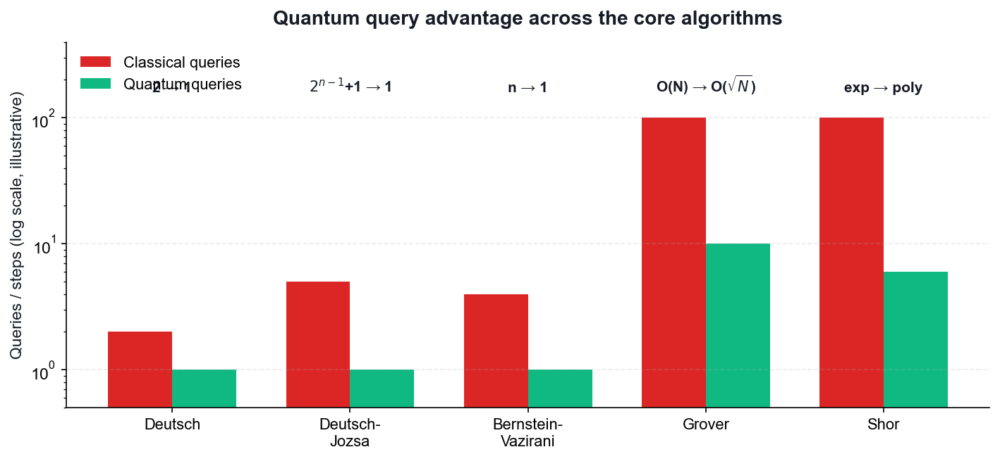
*Query advantage of Deutsch and Deutsch-Jozsa over classical methods.*

**What you'll build**

Deutsch and Deutsch-Jozsa circuits with all four oracle types, run on IBM Quantum hardware, correctly classifying each function in one query.   (Tools: Qiskit 2.x, IBM Quantum Runtime, OpenQASM.)

**Step-by-step**

1. Open the lab09 folder and review the four oracle constructions in main.py.

   ```python
   cd labs/lab09 && cat main.py
   ```

2. Understand the oracle convention |x>|y> maps to |x>|y XOR f(x)>, which keeps the operation reversible.
3. Build the Deutsch circuit: initialise q1 to |1>, apply Hadamard to both qubits.

   ```python
   qc = QuantumCircuit(2, 1)
   qc.x(1); qc.h(0); qc.h(1)
   ```

4. Apply the oracle for the balanced_identity case, which is a single CNOT.

   ```python
   qc.cx(0, 1)
   ```

5. Apply a final Hadamard to q0 and measure it — 0 means constant, 1 means balanced.

   ```python
   qc.h(0); qc.measure(0, 0)
   ```

6. Run the circuit against all four oracles and confirm each is classified correctly in one query.

   ```python
   python labs/lab09/main.py
   ```

7. Explain how phase kickback makes the oracle mark the input register rather than the output register.
8. Open main-deutsch-jozsa.py in lab09 and review how the oracle generalises to n input qubits.

   ```python
   cat labs/lab09/main-deutsch-jozsa.py
   ```

9. Run the Deutsch-Jozsa algorithm and confirm that an all-zeros measurement means constant and any other result means balanced.

   ```python
   python main.py
   ```

10. Compare the single quantum query against the 2^(n-1)+1 classical queries needed in the worst case.

**Test it**

The Deutsch circuit measures 0 for both constant oracles and 1 for both balanced oracles; Deutsch-Jozsa returns the all-zeros string for a constant function and a non-zero string for a balanced function — each using exactly one oracle query.

> **Note:** The reference implementation for this activity is in labs/lab09/. Read the source before you run it — understanding the circuit matters more than the output.

---


### Activity 10 — Bernstein-Vazirani Algorithm

Learning outcome: LO6 — Establish guidelines for selecting quantum computing algorithms.

Goal: Recover an n-bit hidden string in a single oracle query. Classically you would need n queries — one per bit — making this a clean demonstration of linear-to-constant query speedup.


*Bernstein-Vazirani recovers an n-bit string in one query instead of n.*

**What you'll build**

A Bernstein-Vazirani circuit that recovers a chosen hidden string such as 1011 in one query on real hardware.   (Tools: Qiskit 2.x, IBM Quantum Runtime.)

**Step-by-step**

1. Open the lab10 folder and choose a hidden string, for example s = 1011.

   ```python
   cd labs/lab10 && cat main.py
   ```

2. Create a circuit with n input qubits plus one ancilla, and set the ancilla to |1>.

   ```python
   qc = QuantumCircuit(5, 4)
   qc.x(4)
   ```

3. Apply Hadamard gates to every qubit including the ancilla.

   ```python
   qc.h(range(5))
   ```

4. Build the oracle by placing a CNOT from input qubit i to the ancilla wherever bit i of s is 1.

   ```python
   for i, bit in enumerate(reversed('1011')):
       if bit == '1': qc.cx(i, 4)
   ```

5. Apply Hadamard gates to the input qubits again to complete the interference step.

   ```python
   qc.h(range(4))
   ```

6. Measure the input register and run the circuit on IBM Quantum hardware.

   ```python
   python labs/lab10/main.py
   ```

7. Confirm the most frequent measurement outcome is exactly the hidden string s.
8. Repeat with a different hidden string and verify the algorithm recovers it in one query again.
9. Explain why n classical queries are required to learn n bits, while the quantum circuit needs only one.

**Test it**

The most frequent measured bit string equals the hidden string s that was encoded in the oracle, recovered with a single oracle query regardless of the length of s.

> **Note:** The reference implementation for this activity is in labs/lab10/. Read the source before you run it — understanding the circuit matters more than the output.

---


### Activity 11 — Grover's Search Algorithm

Learning outcome: LO6, LO7 — Select algorithms and synthesize quantum methodologies.

Goal: Implement amplitude amplification to find a marked item in an unstructured search space, using the phase oracle and the diffuser, and see the quadratic O(sqrt(N)) speedup for 2-qubit and 3-qubit searches.

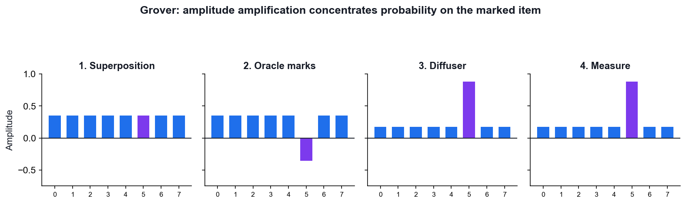
*Grover: the oracle marks, the diffuser amplifies.*

**What you'll build**

Grover circuits for 2 and 3 qubits that amplify the marked state to a high measurement probability on real hardware.   (Tools: Qiskit 2.x, IBM Quantum Runtime, OpenQASM.)

**Step-by-step**

1. Open the lab11 folder, which contains both the 2-qubit and 3-qubit versions.

   ```python
   cd labs/lab11 && cat main.py
   ```

2. Initialise the register in an equal superposition of all N = 2^n basis states with Hadamards.

   ```python
   qc = QuantumCircuit(2, 2)
   qc.h([0, 1])
   ```

3. Build the phase oracle that flips the sign of the marked state — for |11> this is a controlled-Z.

   ```python
   qc.cz(0, 1)
   ```

4. Build the diffuser: Hadamards, X gates, a controlled-Z, then X gates and Hadamards again.

   ```python
   qc.h([0,1]); qc.x([0,1]); qc.cz(0,1); qc.x([0,1]); qc.h([0,1])
   ```

5. Measure the register and run the 2-qubit search — one Grover iteration is optimal here.

   ```python
   python labs/lab11/main.py
   ```

6. Confirm the marked state is measured with close to 100% probability after a single iteration.
7. Move to the 3-qubit case and compute the optimal number of iterations as about pi/4 times sqrt(N).
8. Run the 3-qubit search with 2 iterations and confirm the marked state dominates the histogram.
9. Demonstrate over-rotation by applying too many iterations and observing the success probability fall.
10. Compare the O(sqrt(N)) quantum queries against the O(N) classical brute-force search.

**Test it**

For 2 qubits the marked state is measured with near-certainty after one Grover iteration; for 3 qubits it dominates the histogram after two iterations; applying too many iterations visibly reduces the success probability.

> **Note:** The reference implementation for this activity is in labs/lab11/. Read the source before you run it — understanding the circuit matters more than the output.

---


### Activity 12 — Quantum Fourier Transform

Learning outcome: LO6, LO7 — Establish guidelines for selecting quantum computing algorithms.

Goal: Build the QFT circuit from Hadamard and controlled-phase gates, verify it against the classical DFT, and understand why it is the engine behind phase estimation and Shor's algorithm.

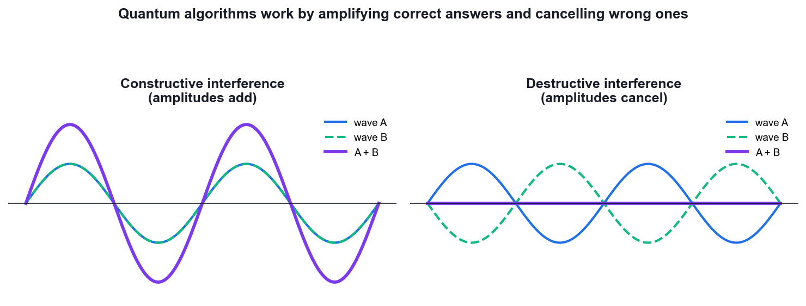
*The QFT works by controlled interference of amplitudes.*

**What you'll build**

QFT circuits for 3, 4 and 5 qubits, validated against a classical DFT reference and run on IBM Quantum hardware.   (Tools: Qiskit 2.x, NumPy, IBM Quantum Runtime, OpenQASM.)

**Step-by-step**

1. Open the lab12 folder, which provides 3, 4 and 5 qubit versions.

   ```python
   cd labs/lab12 && cat main.py
   ```

2. Apply a Hadamard to the most significant qubit to begin the QFT construction.

   ```python
   qc = QuantumCircuit(3)
   qc.h(2)
   ```

3. Apply controlled-phase rotations of pi/2, pi/4 and so on from each lower qubit to the current one.

   ```python
   import numpy as np
   qc.cp(np.pi/2, 1, 2); qc.cp(np.pi/4, 0, 2)
   ```

4. Repeat the Hadamard and controlled-phase pattern for each remaining qubit in turn.

   ```python
   qc.h(1); qc.cp(np.pi/2, 0, 1); qc.h(0)
   ```

5. Add the final SWAP gates that reverse the qubit order to match the standard QFT convention.

   ```python
   qc.swap(0, 2)
   ```

6. Compare your circuit against Qiskit's built-in QFT to confirm they are equivalent.

   ```python
   from qiskit.circuit.library import QFT
   print(QFT(3).decompose())
   ```

7. Verify the output against a classical NumPy FFT of the same input state vector.

   ```python
   np.fft.fft(state) / np.sqrt(len(state))
   ```

8. Run the 3-qubit QFT on IBM Quantum hardware and inspect the transpiled circuit depth.

   ```python
   python labs/lab12/main.py
   ```

9. Count the gates and confirm the QFT uses O(n^2) gates versus O(N log N) for the classical FFT.

**Test it**

Your hand-built QFT circuit produces the same state vector as Qiskit's built-in QFT and matches a normalised classical FFT of the same input, using on the order of n^2 gates.

> **Note:** The reference implementation for this activity is in labs/lab12/. Read the source before you run it — understanding the circuit matters more than the output.

---


## Topic 06 — Quantum Cryptography and Quantum Safety

Classical Cryptography · The Quantum Threat · Shor Algorithm · Post-Quantum Cryptography

**Key concepts**

- Goals of cryptography — Confidentiality, integrity, authentication and non-repudiation are the four properties every scheme must address.
- Classical schemes — Symmetric (AES), asymmetric (RSA, ECC) and hash functions (SHA-256) rest on problems that are hard for classical computers.
- The quantum threat — Shor's algorithm breaks RSA and ECC in polynomial time; Grover halves the effective key length of symmetric ciphers.
- Shor's algorithm — Reduces factoring to period-finding, then uses the QFT to extract the period — turning a hard problem into an easy one.
- Harvest now, decrypt later — Adversaries can record encrypted traffic today and decrypt it once a cryptographically relevant quantum computer exists.
- Post-quantum cryptography — NIST has standardised ML-KEM (Kyber), ML-DSA (Dilithium), SLH-DSA (SPHINCS+) and HQC as quantum-resistant replacements.


### Post-Quantum Hardening — Practical Migration

**The threat timeline**

```bash
Three dates decide your risk (Mosca's theorem):

   X  =  how long your data must stay secret        (years)
   Y  =  how long migration will take you           (years)
   Z  =  time until a cryptographically relevant QC (years)

   IF   X + Y  >  Z    then you are ALREADY exposed.

Health records X=25y, migration Y=5y, Z estimated 10-15y  ->  act now.
```

> **Note:** Mosca's inequality turns a vague fear into a concrete deadline you can put in front of a board.

**Step 1 — Build a cryptographic inventory (CBOM)**

```bash
You cannot migrate what you cannot see. Enumerate:

   • TLS certificates and their key algorithms
   • VPNs, SSH keys, code-signing certificates
   • database and backup encryption
   • hardcoded crypto in applications and firmware
   • third-party and SaaS dependencies

Produce a Cryptographic Bill of Materials (CBOM). Tools: CBOM/CycloneDX,
sslyze, openssl scanning, source-code scanners.
```

> **Note:** Most organisations discover far more RSA and ECC than they expected, especially embedded in vendor products.

**Step 2 — Classify and prioritise**

```bash
   BROKEN by Shor      RSA, ECC, ECDSA, ECDH, DH, DSA   ->  must replace
   WEAKENED by Grover  AES-128, SHA-256                 ->  double key size
   SAFE                AES-256, SHA-512, SHA-3          ->  keep

Priority score = (data lifetime) × (exposure) × (replacement difficulty)

Rank highest: long-lived secrets, long-lived devices, anything whose
traffic crosses an untrusted network today.
```

> **Note:** Harvest-now-decrypt-later means long confidentiality lifetimes dominate the ranking — not how sensitive the system feels today.

**Step 3 — Deploy the NIST standards**

```bash
   FIPS 203  ML-KEM   (Kyber)     key encapsulation — replaces RSA/ECDH
   FIPS 204  ML-DSA   (Dilithium) signatures — the general-purpose default
   FIPS 205  SLH-DSA  (SPHINCS+)  hash-based signatures — conservative backup
   2025      HQC                  code-based KEM — algorithmic diversity

Chosen for structural DIVERSITY: lattice, hash and code-based problems,
so one mathematical breakthrough cannot break everything at once.
```

> **Note:** SLH-DSA has larger signatures but rests only on hash-function security — the most conservative assumption available.

**Step 4 — Hybrid mode during transition**

```bash
Run classical AND post-quantum together, combining both shared secrets:

   shared_secret  =  KDF( ECDH_secret  ||  ML-KEM_secret )

The session stays secure if EITHER component holds.

Already deployed: X25519+ML-KEM768 in Chrome, Firefox, Cloudflare,
Signal (PQXDH), Apple iMessage (PQ3), OpenSSH 9.x.
```

> **Note:** Hybrid protects against both a future quantum attack AND an implementation flaw in the new, less battle-tested PQC code.

**Step 5 — Build crypto-agility**

```bash
The real lesson of this migration is that there will be ANOTHER one.

   • never hardcode algorithms — make them configuration
   • negotiate algorithms at the protocol level
   • centralise crypto in a library or service, not scattered in apps
   • keep certificate lifetimes short so rotation is routine
   • test algorithm swaps in CI

Design goal: changing algorithm should be a CONFIG change, not a rewrite.
```

> **Note:** Organisations that built crypto-agility for the SHA-1 to SHA-2 migration are finding the PQC transition dramatically cheaper.

---


### Quantum Security — The Complete Picture

**Two meanings of 'quantum security'**

```bash
   1. SECURITY AGAINST quantum computers
      = Post-Quantum Cryptography (PQC)
      Classical maths, classical hardware, believed quantum-resistant.
      Runs on the machines you already own.

   2. SECURITY USING quantum physics
      = QKD, QRNG, device-independent cryptography
      Needs quantum hardware; security from physical law.
```

> **Note:** These are constantly conflated in vendor marketing. Know which one is being sold to you.

**The quantum threat model**

```bash
   SHOR   breaks RSA, DH, ECC, ECDSA outright — polynomial time.
          All public-key crypto in use today fails.

   GROVER halves effective symmetric key length.
          AES-128 -> ~64-bit security;  AES-256 stays safe.
          (In practice the parallelisation penalty makes this weaker still.)

   HARVEST NOW, DECRYPT LATER
          The attack is happening TODAY. Encrypted traffic is being
          recorded now for decryption once a CRQC exists.
```

> **Note:** Note the asymmetry: symmetric crypto survives with bigger keys; public-key crypto must be replaced entirely.

**QKD vs PQC — an honest comparison**

```bash
   QKD                              PQC
   security from physics            security from hard maths
   needs dedicated fibre/satellite  runs on existing hardware
   ~100-500 km without repeaters    unlimited range (internet)
   expensive dedicated hardware     software update
   no authentication built in       signatures included
   point-to-point links             works at internet scale

NSA/NCSC advise PQC for general use; QKD suits specific high-value links.
```

> **Note:** QKD is NOT a drop-in replacement for public-key infrastructure — it still needs an authenticated classical channel to prevent man-in-the-middle.

**Quantum random number generation (QRNG)**

```bash
Classical PRNGs are DETERMINISTIC — given the seed, the output follows.

QRNG derives randomness from a genuinely indeterministic quantum event:
   • which path a photon takes at a beamsplitter
   • vacuum fluctuation amplitude
   • arrival-time jitter of photons

Axiom 4 (the Born rule) guarantees the outcome is fundamentally random,
not merely hard to predict.
```

> **Note:** QRNG is the most mature and deployable quantum security technology today — and weak randomness is a very common real-world failure.

**Defence-in-depth for the quantum era**

```bash
   NOW      inventory crypto; switch to AES-256 and SHA-384/512;
            deploy hybrid key exchange; buy crypto-agility

   NEXT     migrate signatures to ML-DSA; PQC certificate chains;
            update embedded and IoT firmware pipelines

   ONGOING  monitor NIST/vendor guidance; re-run the CBOM;
            treat algorithm agility as a permanent capability

   SPECIAL  QKD only where the threat model and budget genuinely justify it
```

> **Note:** The sequencing matters: confidentiality (harvest-now risk) before authenticity (which an attacker must break in real time).

---


### Proof — Shor's Algorithm Breaks RSA

**Claim**

Factoring reduces to period finding, which a quantum computer solves in polynomial time.

**Given**

- Goal: factor a composite N (e.g. an RSA modulus).
- Best known classical method (GNFS) is sub-exponential: exp(O((log N)^(1/3))).
- Shor runs in O((log N)³) — polynomial.

**Step 1 — Reduce factoring to order finding**

```bash
Pick a random a with 1 < a < N.
If gcd(a, N) ≠ 1 we already have a factor (lucky — done).

Otherwise find the ORDER r: the smallest r > 0 with
   a^r ≡ 1  (mod N)
```

> **Note:** This reduction is entirely CLASSICAL number theory — no quantum yet.

**Step 2 — Why the order gives a factor**

```bash
If r is EVEN, then a^r - 1 ≡ 0 (mod N) factors as:

   (a^(r/2) - 1)(a^(r/2) + 1)  ≡  0   (mod N)

So N divides that product. Provided a^(r/2) ≢ -1 (mod N),
   gcd(a^(r/2) - 1, N)  and  gcd(a^(r/2) + 1, N)
are NON-TRIVIAL factors of N.

P(r even AND the condition holds) ≥ 1/2 for random a — so a few tries suffice.
```

> **Note:** gcd is computed classically in polynomial time by Euclid's algorithm.

**Step 3 — Worked example: N = 15, a = 7**

```bash
Powers of 7 mod 15:
   7¹ = 7,  7² = 49 ≡ 4,  7³ ≡ 28 ≡ 13,  7⁴ ≡ 91 ≡ 1

So r = 4 (even, good).
   a^(r/2) = 7² = 49 ≡ 4 (mod 15),  and 4 ≢ -1, so we may proceed.

   gcd(4 - 1, 15) = gcd(3, 15) = 3
   gcd(4 + 1, 15) = gcd(5, 15) = 5

   15 = 3 × 5      FACTORED
```

> **Note:** Everything here was classical — the only hard step is FINDING r.

**Step 4 — The quantum part: period finding**

```bash
Prepare a counting register in superposition and compute a^x mod N:

   (1/√Q) Σ_x |x> |a^x mod N>

Measure the second register. It collapses to some value a^(x₀) mod N,
leaving the first register in a superposition of all x with the same value:

   |x₀> + |x₀ + r> + |x₀ + 2r> + …

— a PERIODIC state with period exactly r.
```

> **Note:** The period is encoded in the register, but measuring directly would just give one random x — useless. The QFT is needed to expose the period.

**Step 5 — The QFT extracts the period**

```bash
Apply the inverse QFT to the counting register.

The QFT of a periodic comb is a comb with reciprocal spacing: the amplitude
concentrates on multiples of Q/r. Measuring yields, with high probability,

   y  ≈  k·Q/r      for some integer k

Then  y/Q ≈ k/r, and CONTINUED FRACTIONS recover r from that rational
approximation.
```

> **Note:** The QFT costs only O(n²) gates — this is where the exponential speedup lives.

**Step 6 — Cost and consequence**

```bash
Total: O((log N)³) operations — POLYNOMIAL in the number of bits.

RSA-2048 estimates: roughly 4,000 logical qubits and ~10⁹ Toffoli gates,
which at realistic error rates means MILLIONS of physical qubits.

Shor also breaks Diffie-Hellman and ECC (the discrete-log problem).
```

> **Note:** Not achievable today — but 'harvest now, decrypt later' means data captured today is already at risk.

**Result**

Given the order r of a mod N, the factors follow classically from gcd(a^(r/2) ± 1, N). The quantum computer supplies r in polynomial time via the QFT.

**Why it matters**

Shor is the reason post-quantum cryptography exists. Every public-key system in use today — RSA, DH, ECDSA — is broken by it, which is why NIST standardised ML-KEM, ML-DSA and SLH-DSA.

---


### Activity 13 — Shor's Algorithm and the Quantum Threat to RSA

Learning outcome: LO7 — Synthesize quantum methodologies to address complex problems.

Goal: See how factoring reduces to period finding, run the quantum period-finding circuit that sits at the heart of Shor's algorithm, and recover the factors of N = 15 from the measured period.

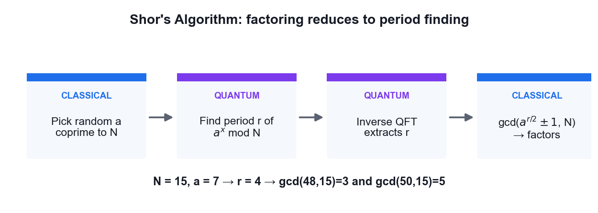
*Shor's algorithm: factoring reduced to quantum period finding.*

**What you'll build**

A period-finding circuit whose measured output yields the period r, from which the factors of N = 15 are classically recovered.   (Tools: Qiskit 2.x, IBM Quantum Runtime, Python, OpenQASM.)

**Step-by-step**

1. Open the lab13 folder and review the period-finding construction in main.py.

   ```python
   cd labs/lab13 && cat main.py
   ```

2. Understand the classical reduction: to factor N, pick a random a coprime to N and find the period r of a^x mod N.
3. Verify the reduction by hand for N = 15 and a = 7, listing the powers of 7 mod 15 until the sequence repeats.

   ```python
   # 7, 4, 13, 1, 7, ...  -> r = 4
   ```

4. Build the counting register in superposition with Hadamard gates.

   ```python
   qc.h(range(n_count))
   ```

5. Apply the controlled modular-exponentiation operations that encode a^x mod N.
6. Apply the inverse QFT to the counting register to extract the period information.

   ```python
   qc.append(QFT(n_count, inverse=True), range(n_count))
   ```

7. Measure the counting register and run the circuit on IBM Quantum hardware.

   ```python
   python labs/lab13/main.py
   ```

8. Use the continued-fractions method on the measured phase to recover the period r.
9. Compute the factors as gcd(a^(r/2) +/- 1, N) and confirm you obtain 3 and 5.

   ```python
   from math import gcd
   print(gcd(7**2 - 1, 15), gcd(7**2 + 1, 15))   # 3, 5
   ```

10. Estimate how many logical qubits would be required to factor a 2048-bit RSA modulus, and discuss the timeline risk.

**Test it**

The measured phase yields period r = 4 for a = 7 and N = 15, and the classical post-processing step recovers the correct factors 3 and 5.

> **Note:** The reference implementation for this activity is in labs/lab13/. Read the source before you run it — understanding the circuit matters more than the output.

---


### Activity 14 — Post-Quantum Cryptography Migration Assessment

Learning outcome: LO4, LO7 — Evaluate quantum applicability in the business context.

Goal: Assess which cryptography in a realistic system is broken by a quantum computer, map each algorithm to its NIST post-quantum replacement, and produce a prioritised migration plan against the harvest-now-decrypt-later risk.

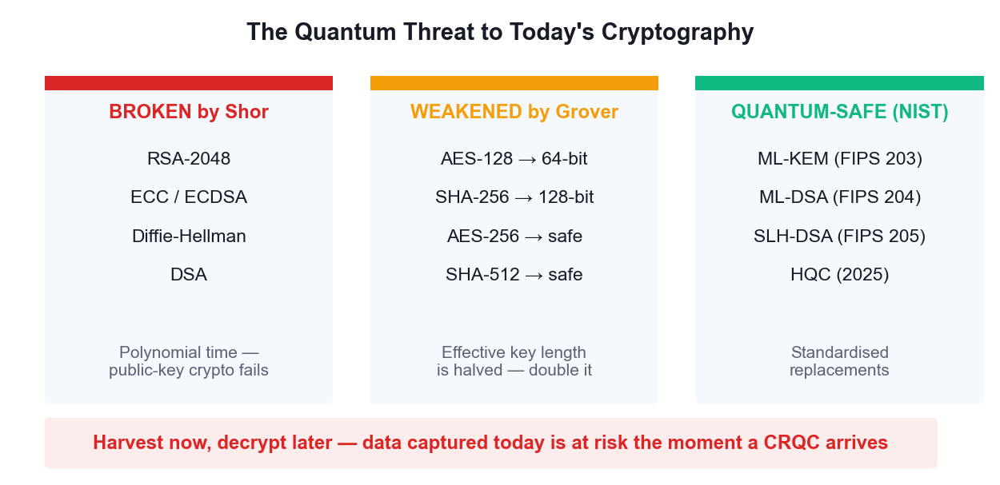
*What breaks, what is weakened, and the NIST replacements.*

**What you'll build**

A completed cryptographic inventory and a prioritised PQC migration plan for a sample organisation.   (Tools: NIST FIPS 203/204/205, OpenSSL, Python.)

**Step-by-step**

1. List the cryptography used in a typical enterprise: TLS certificates, VPNs, code signing, database encryption and backups.
2. Inspect a real certificate to identify its public-key algorithm and key size.

   ```python
   openssl s_client -connect www.tertiarycourses.com.sg:443 </dev/null 2>/dev/null | openssl x509 -noout -text | grep -A2 'Public Key Algorithm'
   ```

3. Classify each algorithm as broken by Shor (RSA, ECC, Diffie-Hellman) or merely weakened by Grover (AES, SHA-2).
4. Record that Grover halves the effective key length, so AES-128 falls to 64-bit security while AES-256 remains safe.
5. Map each broken algorithm to its NIST replacement: ML-KEM for key exchange, ML-DSA or SLH-DSA for signatures.
6. Note the standards: FIPS 203 (ML-KEM/Kyber), FIPS 204 (ML-DSA/Dilithium) and FIPS 205 (SLH-DSA/SPHINCS+).
7. Score each asset for harvest-now-decrypt-later risk based on how long its data must stay confidential.
8. Identify which systems need crypto-agility first — long-lived secrets and long-lived devices rank highest.
9. Produce a prioritised migration table listing asset, current algorithm, PQC replacement, risk score and target date.
10. Recommend hybrid classical-plus-PQC key exchange as the safe transitional deployment strategy.

**Test it**

Your inventory correctly separates Shor-broken asymmetric algorithms from Grover-weakened symmetric ones, maps each to the correct NIST FIPS standard, and ranks migration priority by how long the data must remain confidential.

> **Note:** The reference implementation for this activity is in labs/lab14/. Read the source before you run it — understanding the circuit matters more than the output.

---


## Topic 07 — Quantum Computing Applications and Use Cases

Finance · Healthcare · Science

**Key concepts**

- Finance — Portfolio optimisation, derivative pricing via amplitude estimation, credit risk and fraud detection are the leading finance use cases.
- Healthcare and life sciences — Molecular simulation with VQE, protein folding and accelerated drug discovery target problems classical HPC cannot reach.
- Science and materials — Simulating catalysts, superconductors, nitrogen fixation and battery chemistry is quantum computing's most natural application.
- Optimisation and logistics — QAOA addresses routing, scheduling and Max-Cut style combinatorial problems across supply chains and energy grids.
- Quantum machine learning — Quantum kernels and variational classifiers explore feature spaces that are expensive to compute classically.
- Assessing business value — Evaluate a use case on problem structure, data size, required qubit count and whether a classical method already suffices.


### Quantum Computing and AI

**Four distinct intersections**

```bash
   1. QUANTUM FOR AI    — quantum algorithms to speed up machine learning
   2. AI FOR QUANTUM    — machine learning to make quantum computers work
   3. QUANTUM-INSPIRED  — classical algorithms borrowed from quantum ideas
   4. SHARED INFRASTRUCTURE — hybrid classical/quantum/GPU pipelines

Intersection 2 is where the REAL commercial value sits today —
which is the reverse of what most headlines suggest.
```

> **Note:** Be precise about which intersection is being discussed; they have completely different maturity levels.

**Quantum machine learning — the honest state**

```bash
   QUANTUM KERNELS     map data into a Hilbert space and compute inner
                       products a classical kernel cannot easily reach
   VARIATIONAL (VQC)   parameterised circuits trained like a neural net
   QUANTUM NEURAL NETS layered ansätze with gradient-based training

REALITY CHECK:
   • data loading is the bottleneck — encoding N classical values can
     cost O(N), destroying any speedup
   • BARREN PLATEAUS: gradients vanish exponentially with qubit count
   • no proven advantage on a real-world ML dataset yet
```

> **Note:** Teach this honestly. Quantum ML is a genuine research field with real open problems, not a shipping product.

**AI for quantum — the part that works today**

```bash
Machine learning is already ESSENTIAL to running quantum hardware:

   • QUBIT CALIBRATION — RL agents tune pulse parameters continuously
   • ERROR DECODING — neural decoders beat classical matching on surface
     codes, and run fast enough for real-time correction
   • CIRCUIT COMPILATION — ML finds better gate decompositions and routing
   • NOISE CHARACTERISATION — learn the device error model, then mitigate
   • ANSATZ DESIGN — search the space of variational circuits

Google, IBM and Quantinuum all use ML decoders in production stacks.
```

> **Note:** This is the intersection with proven, deployed value — and a strong career area for someone with both skill sets.

**Quantum-inspired classical algorithms**

```bash
Studying quantum algorithms has produced better CLASSICAL ones:

   • TENSOR NETWORKS (MPS, PEPS) — from quantum many-body physics,
     now used to compress neural networks
   • Ewin Tang's 'dequantisation' — classical algorithms matching the
     quantum recommendation-system speedup
   • simulated annealing variants inspired by quantum annealing

A quantum algorithm that gets dequantised is still a scientific win —
you end up with a faster classical method.
```

> **Note:** Useful framing for business stakeholders: quantum R&D pays dividends even when the quantum hardware is not ready.

**Where they converge: chemistry**

```bash
The most credible near-term combination:

   1. QUANTUM computer simulates a molecule that is classically intractable
   2. Results become high-quality TRAINING DATA
   3. An AI MODEL (e.g. a graph neural net) learns from that data
   4. The AI screens MILLIONS of candidate molecules cheaply
   5. The quantum computer verifies only the top candidates

Quantum supplies scarce, high-accuracy ground truth; AI supplies scale.
```

> **Note:** This division of labour plays to each technology's actual strength instead of pitting them against each other.

**Security implications of the convergence**

```bash
   AI ACCELERATES CRYPTANALYSIS — ML-assisted side-channel attacks and
     lattice-reduction heuristics are active research areas

   PQC MUST PROTECT AI SYSTEMS — model weights, training data and
     inference APIs all need quantum-safe transport and signing

   AI DEFENDS — anomaly detection can flag harvest-now traffic capture

   MODEL PROVENANCE — signing model artifacts with ML-DSA guards the
     AI supply chain against tampering
```

> **Note:** Model weights are long-lived, extremely high-value secrets — a textbook harvest-now-decrypt-later target.

**Realistic outlook**

```bash
   TODAY (NISQ)      AI runs quantum hardware. Quantum ML is research.
   ~2029 (early FT)  first logical qubits; quantum chemistry feeds AI
                     training sets; PQC migration should be complete
   2030s             fault-tolerant chemistry and materials at scale;
                     quantum-generated data becomes routine in AI pipelines

   CONSTANT          the security work does NOT wait for any of this.
                     Harvest-now-decrypt-later is a TODAY problem.
```

> **Note:** The security timeline is independent of the computing timeline — that is the single most important message to take back to work.

---


### Activity 15 — Molecular Simulation with VQE (Healthcare & Science)

Learning outcome: LO4, LO7 — Evaluate quantum computing applicability in the business context.

Goal: Run the Variational Quantum Eigensolver to compute the ground-state energy of the hydrogen molecule — the flagship near-term use case for drug discovery, catalysis and materials science.

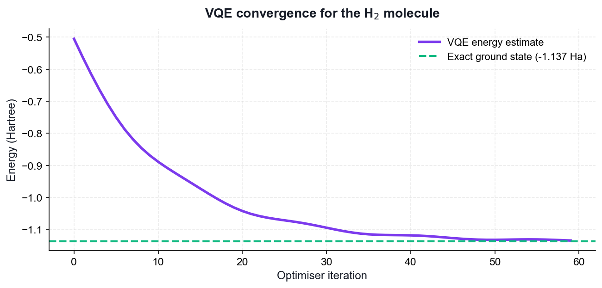
*VQE convergence toward the H2 ground-state energy.*

**What you'll build**

A VQE run that converges to the H2 ground-state energy, with an energy-versus-iteration convergence plot.   (Tools: Qiskit 2.x, SciPy optimiser, matplotlib, IBM Quantum.)

**Step-by-step**

1. Open the lab15 folder and review the ansatz and Hamiltonian definitions in main.py.

   ```python
   cd labs/lab15 && cat main.py
   ```

2. Understand the hybrid loop: a parameterised quantum circuit prepares a trial state, a classical optimiser updates the parameters.
3. Inspect the H2 Hamiltonian expressed as a weighted sum of Pauli strings.
4. Build the parameterised ansatz circuit whose rotation angles are the variational parameters.
5. Define the cost function that measures the expectation value of the Hamiltonian for a given parameter set.
6. Run the classical optimiser to minimise the energy over the parameters.

   ```python
   python labs/lab15/main.py
   ```

7. Plot energy against iteration and confirm the value converges downward toward the ground state.
8. Compare the converged energy against the known exact H2 ground-state energy of about -1.137 Hartree.
9. Explain why VQE suits today's noisy hardware — shallow circuits and a classical optimiser tolerate some noise.
10. Discuss which pharmaceutical and materials problems become tractable as qubit counts grow.

**Test it**

The VQE optimisation converges to an energy close to the exact H2 ground-state value of about -1.137 Hartree, and the convergence plot shows the energy decreasing monotonically toward that limit.

> **Note:** The reference implementation for this activity is in labs/lab15/. Read the source before you run it — understanding the circuit matters more than the output.

---


### Activity 16 — Portfolio Optimisation with QAOA (Finance)

Learning outcome: LO4, LO6 — Evaluate applicability and select appropriate algorithms.

Goal: Apply the Quantum Approximate Optimization Algorithm to a Max-Cut style combinatorial problem, the same structure that underlies portfolio selection, routing and scheduling in financial services.

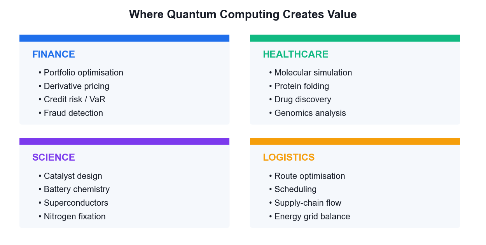
*Where QAOA-style optimisation creates value across sectors.*

**What you'll build**

A QAOA run that finds the optimal cut on a small graph, with the solution quality compared against brute force.   (Tools: Qiskit 2.x, NetworkX, SciPy, matplotlib.)

**Step-by-step**

1. Open the lab16 folder and review the Max-Cut problem definition in main.py.

   ```python
   cd labs/lab16 && cat main.py
   ```

2. Define a small graph whose vertices represent assets and whose edges carry correlation weights.
3. Encode the Max-Cut objective as a cost Hamiltonian built from ZZ terms on each edge.
4. Build the QAOA circuit alternating the cost Hamiltonian and the mixer Hamiltonian for p layers.
5. Initialise the register in equal superposition with Hadamard gates before the first layer.
6. Run the classical optimiser over the gamma and beta parameters to maximise the expected cut value.

   ```python
   python labs/lab16/main.py
   ```

7. Sample the optimised circuit and identify the most frequent bit string as the proposed solution.
8. Brute-force all 2^n partitions classically and compare the optimal cut against the QAOA result.
9. Increase the number of layers p and observe how the approximation ratio improves.
10. Map the result back to the finance framing: which assets fall on each side of the partition, and why that matters for diversification.

**Test it**

The most frequently sampled bit string from the optimised QAOA circuit corresponds to the true maximum cut found by brute force, and the approximation ratio improves as the number of layers p increases.

> **Note:** The reference implementation for this activity is in labs/lab16/. Read the source before you run it — understanding the circuit matters more than the output.

---


## Topic 08 — Quantum Error Correction

Bit and Phase Flip Errors · QEC Algorithms · Fault Tolerance · The Future

**Key concepts**

- Why QEC is needed — Qubits decohere and gates are imperfect; without correction, errors accumulate long before a useful algorithm completes.
- Quantum-specific challenges — No-cloning forbids simple copying, errors are continuous rather than discrete, and measurement destroys the state.
- Syndrome measurement — Ancilla qubits are measured to reveal WHICH error occurred without ever measuring — and collapsing — the logical state.
- Bit-flip and phase-flip codes — Three-qubit repetition codes correct X errors; conjugating with Hadamards turns phase flips into bit flips.
- Shor, Steane and surface codes — Shor's 9-qubit code corrects arbitrary single-qubit errors; Steane uses 7; surface codes are today's leading practical approach.
- Fault tolerance — Below the error threshold, concatenating codes suppresses errors faster than they accumulate — the path to useful quantum computers.


### Proof — Quantum Error Correction Works

**Claim**

Syndrome measurement identifies WHICH error occurred without learning — and therefore without collapsing — the encoded logical state.

**Given**

- Encode one logical qubit into three physical qubits (the bit-flip code).
- Logical states:  |0>_L = |000>,  |1>_L = |111>.
- An arbitrary logical state:  |ψ>_L = a|000> + b|111>.
- Assume at most ONE qubit suffers an X (bit-flip) error.

**Step 1 — Why naive copying is forbidden**

```bash
The obvious classical fix is to make three copies:
   |ψ>|ψ>|ψ>  =  (a|0>+b|1>)(a|0>+b|1>)(a|0>+b|1>)

But no-cloning FORBIDS this for unknown |ψ>.

What we build instead is the ENTANGLED state
   a|000> + b|111>     which is NOT  |ψ>|ψ>|ψ>
```

> **Note:** Encoding spreads the information across three qubits without ever duplicating it.

**Step 2 — Encoding circuit**

```bash
Two CNOTs, both controlled by the data qubit:

   (a|0> + b|1>)|0>|0>
     --CNOT(0->1)-->   a|00>|0> + b|11>|0>
     --CNOT(0->2)-->   a|000>   + b|111>

= |ψ>_L
```

> **Note:** Note a and b are never measured, never learned, never copied.

**Step 3 — An error strikes**

```bash
Suppose X acts on qubit 1:

   X₁ (a|000> + b|111>)  =  a|010> + b|101>

The state is corrupted — but observe that the amplitudes a and b are INTACT.
Only the BASIS LABELS have been permuted.
```

> **Note:** This is the crucial observation: the error moved the state to a different, distinguishable subspace without touching the encoded information.

**Step 4 — Syndrome operators**

```bash
Measure the two PARITY observables (stabilisers):

   S₁ = Z₀Z₁     (parity of qubits 0 and 1)
   S₂ = Z₁Z₂     (parity of qubits 1 and 2)

Critically, both COMMUTE with the logical operators, and:
   S₁|000> = +|000>,   S₁|111> = +|111>
so S₁ has the SAME eigenvalue on both logical basis states.
```

> **Note:** Because the eigenvalue does not depend on whether the state is |000> or |111>, measuring it reveals NOTHING about a and b.

**Step 5 — The syndrome table**

```bash
Apply the stabilisers to the corrupted state a|010> + b|101>:

   error     S₁ = Z₀Z₁    S₂ = Z₁Z₂     syndrome
   none          +1           +1           00
   X on q0       -1           +1           10
   X on q1       -1           -1           11
   X on q2       +1           -1           01

Every single-qubit error gives a DISTINCT syndrome.
```

> **Note:** Four outcomes, four distinguishable cases — the code can locate any single bit flip.

**Step 6 — Why the logical state survives**

```bash
Take the corrupted state  a|010> + b|101>:

   S₁ eigenvalue on |010> = -1 ;  on |101> = -1     -> SAME
   S₂ eigenvalue on |010> = -1 ;  on |101> = -1     -> SAME

Both branches share the same syndrome, so measuring it does NOT
distinguish them — the superposition a·(…) + b·(…) is preserved intact.
```

> **Note:** THIS IS THE HEART OF QEC. The measurement projects onto an error subspace, not onto a logical basis state.

**Step 7 — Correction and generalisation**

```bash
Syndrome 11 -> apply X to qubit 1:
   X₁ (a|010> + b|101>)  =  a|000> + b|111>  =  |ψ>_L      RESTORED

PHASE FLIPS: conjugate by Hadamards, since  H X H = Z.
Encode as |+++> / |---> and the same circuit corrects Z errors.

ARBITRARY ERRORS: any single-qubit error is a linear combination
   E = c₀I + c₁X + c₂Y + c₃Z
The syndrome measurement DISCRETISES it — projecting onto one of I, X, Y, Z.
```

> **Note:** Continuous errors become discrete ones. This 'digitisation of errors' is what makes fault tolerance possible at all.

**Step 8 — Shor, Steane and the threshold**

```bash
Shor 9-qubit  = phase-flip code (3) concatenated with bit-flip code (3)
                -> corrects ANY single-qubit error.
Steane 7-qubit = CSS code from the [7,4] Hamming code — same protection,
                fewer qubits, and transversal Clifford gates.
Surface code   = 2D lattice, nearest-neighbour only, threshold ~1%.

THRESHOLD THEOREM: if the physical error rate p is below a threshold p_th,
concatenating the code to level L suppresses the logical error rate as
   p_L  ≈  p_th (p/p_th)^(2^L)     ->  doubly exponential suppression.
```

> **Note:** Below threshold, adding qubits makes the computer MORE reliable — that is the entire promise of fault-tolerant quantum computing.

**Result**

The syndrome identifies the error without revealing a or b, so applying the indicated Pauli correction restores the logical state exactly. Below the error threshold, concatenation suppresses errors faster than they accumulate.

**Why it matters**

Without QEC, decoherence destroys any long computation. Shor's algorithm on RSA-2048 needs billions of reliable operations — impossible with raw physical qubits at today's error rates, but achievable with error-corrected logical qubits.

---


### Activity 17 — Bit-Flip and Phase-Flip Error Correction Codes

Learning outcome: LO7 — Synthesize quantum methodologies to address complex problems.

Goal: Build the three-qubit repetition codes that detect and correct X and Z errors: encode a logical qubit, inject an error, measure the syndrome without collapsing the state, and apply the correction.

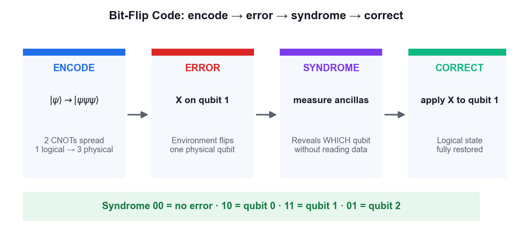
*The bit-flip code cycle: encode, error, syndrome, correct.*

**What you'll build**

Working bit-flip and phase-flip code circuits that correctly identify and repair an injected single-qubit error.   (Tools: Qiskit 2.x, IBM Quantum Runtime, OpenQASM.)

**Step-by-step**

1. Open the lab17 folder and review the bit-flip code implementation in main.py.

   ```python
   cd labs/lab17 && cat main.py
   ```

2. Encode one logical qubit into three physical qubits using two CNOT gates.

   ```python
   qc = QuantumCircuit(5, 2)
   qc.cx(0, 1); qc.cx(0, 2)
   ```

3. Inject a bit-flip error by applying an X gate to one of the three data qubits.

   ```python
   qc.x(1)   # simulate a bit-flip error on qubit 1
   ```

4. Compute the syndrome using two ancilla qubits and four CNOT gates comparing qubit pairs.

   ```python
   qc.cx(0, 3); qc.cx(1, 3); qc.cx(1, 4); qc.cx(2, 4)
   ```

5. Measure only the ancillas — this reveals which qubit flipped without measuring the logical state.

   ```python
   qc.measure([3, 4], [0, 1])
   ```

6. Decode the syndrome: 00 means no error, 10 means qubit 0, 11 means qubit 1 and 01 means qubit 2.
7. Apply the corrective X gate to the qubit identified by the syndrome and confirm the state is restored.
8. Run the bit-flip code on IBM Quantum hardware and verify the correction succeeds.

   ```python
   python labs/lab17/main.py
   ```

9. Run main-phase-flip.py and note that conjugating with Hadamards turns Z errors into X errors.

   ```python
   python labs/lab17/main-phase-flip.py
   ```

10. Explain why measuring the syndrome rather than the data qubits is what makes quantum error correction possible at all.

**Test it**

The syndrome measurement correctly identifies which qubit carried the injected error without collapsing the logical state, and applying the indicated correction restores the original logical qubit.

> **Note:** The reference implementation for this activity is in labs/lab17/. Read the source before you run it — understanding the circuit matters more than the output.

---


### Activity 18 — Shor 9-Qubit and Steane 7-Qubit Codes

Learning outcome: LO7 — Synthesize quantum methodologies to address complex problems.

Goal: Step up to codes that correct arbitrary single-qubit errors: Shor's 9-qubit concatenated code and Steane's more efficient 7-qubit CSS code, then compare their qubit overhead and discuss the road to fault tolerance.

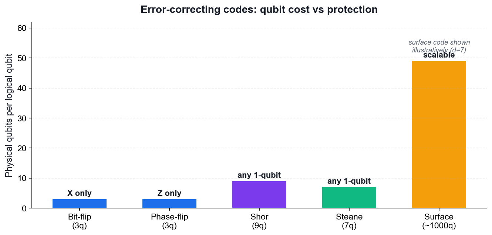
*Qubit cost versus protection for the main error-correcting codes.*

**What you'll build**

Working Shor 9-qubit and Steane 7-qubit code circuits, with a comparison of qubit cost against protection offered.   (Tools: Qiskit 2.x, IBM Quantum Runtime, OpenQASM.)

**Step-by-step**

1. Open the lab18 folder and review how main.py concatenates the phase-flip and bit-flip codes.

   ```python
   cd labs/lab18 && cat main.py
   ```

2. Understand the structure: one logical qubit becomes three blocks of three, protecting against both X and Z errors.
3. Encode the logical qubit across all nine physical qubits.
4. Inject an arbitrary single-qubit error — X, Z or Y — into any one of the nine qubits.
5. Measure the syndrome and confirm the code identifies and corrects the error whichever type it was.

   ```python
   python main.py
   ```

6. Open main-steane.py in lab18 and review the CSS construction based on the Hamming code.

   ```python
   cat labs/lab18/main-steane.py
   ```

7. Run the Steane code and confirm it also corrects an arbitrary single-qubit error using only seven qubits.

   ```python
   python main.py
   ```

8. Compare the overhead of the two codes and note why Steane is more efficient than Shor.
9. Read about surface codes and why their 2D nearest-neighbour layout suits real superconducting hardware.
10. Discuss the error threshold: below it, concatenating codes suppresses errors faster than they accumulate.

**Test it**

Both the Shor 9-qubit and Steane 7-qubit circuits detect and correct an arbitrary injected single-qubit error (X, Y or Z), and you can state the qubit overhead each code requires.

> **Note:** The reference implementation for this activity is in labs/lab18/. Read the source before you run it — understanding the circuit matters more than the output.

---


## Quantum Gate Reference

Use this table as a quick reference during the activities and the open-book assessment.

- X (Pauli-X) — the quantum NOT gate; maps |0⟩ to |1⟩ and |1⟩ to |0⟩. Self-inverse and Hermitian.
- Y (Pauli-Y) — combines a bit flip and a phase flip; equal to iXZ.
- Z (Pauli-Z) — the phase flip; leaves |0⟩ unchanged and maps |1⟩ to −|1⟩.
- H (Hadamard) — creates superposition; maps |0⟩ to |+⟩ and |1⟩ to |−⟩. Self-inverse.
- S and T — phase gates applying π/2 and π/4 respectively; S is the square root of Z, T of S.
- Rx, Ry, Rz — arbitrary rotations about the x, y and z axes of the Bloch sphere.
- CNOT (CX) — flips the target qubit if the control is |1⟩; the workhorse entangling gate.
- CZ — applies a phase of −1 only to the |11⟩ component; symmetric in its two qubits.
- SWAP — exchanges the states of two qubits; often needed to satisfy hardware connectivity.
- Toffoli (CCX) — flips the target only if BOTH controls are |1⟩; makes classical logic reversible.


## Algorithm Selection Guide

Use this decision guide to choose an appropriate quantum algorithm — this directly supports LO6.

- Deciding a global property of a black-box function (constant vs balanced) — use Deutsch or Deutsch-Jozsa.
- Recovering a hidden linear structure or bit string — use Bernstein-Vazirani.
- Searching an unstructured space with no exploitable structure — use Grover for a quadratic speedup.
- Extracting periodicity or an eigenvalue phase — use the Quantum Fourier Transform or phase estimation.
- Factoring integers or computing discrete logarithms — use Shor's algorithm.
- Finding the ground-state energy of a molecule on noisy hardware — use VQE.
- Solving a combinatorial optimisation problem on noisy hardware — use QAOA.
- If a classical algorithm already solves the problem efficiently, quantum computing adds no advantage — this judgement is itself an assessable skill.


## Post-Quantum Cryptography Quick Reference

- Broken by Shor's algorithm: RSA, Diffie-Hellman, DSA, ECC and ECDSA — all public-key cryptography based on factoring or discrete logarithms.
- Weakened by Grover's algorithm: symmetric ciphers and hash functions lose half their effective key length, so AES-128 falls to 64-bit security while AES-256 remains safe.
- FIPS 203 — ML-KEM (formerly CRYSTALS-Kyber), the standard for key encapsulation.
- FIPS 204 — ML-DSA (formerly CRYSTALS-Dilithium), the primary standard for digital signatures.
- FIPS 205 — SLH-DSA (formerly SPHINCS+), a hash-based signature alternative.
- HQC — selected by NIST in 2025 as a backup key-encapsulation mechanism based on error-correcting codes.
- Migration strategy: inventory your cryptography, prioritise long-lived secrets, and deploy hybrid classical-plus-post-quantum key exchange during the transition.


## Assessment Preparation

- The Written Assessment (WA) is 1 hour of open-ended short-answer questions covering all eight topics.
- The Practical Performance (PP) is 1 hour of hands-on quantum circuit and algorithm tasks.
- Both are OPEN BOOK — you may use the course slides, this Learner Guide and approved materials.
- Re-run every activity from a blank notebook until you can build the circuits without referring back.
- Be able to explain, in your own words, why each algorithm achieves its speedup.
- Practise stating which quantum principle each protocol depends on — no-cloning, entanglement, interference or phase kickback.
- Remember to complete the TRAQOM survey and the Assessment digital attendance on assessment day.


## Glossary

- **Qubit** — The basic unit of quantum information — a two-level system that can hold a superposition of |0⟩ and |1⟩.
- **Superposition** — A quantum state that is a weighted combination of basis states, described by complex amplitudes.
- **Amplitude** — The complex number whose squared magnitude gives the probability of a measurement outcome.
- **Born rule** — The rule that the probability of outcome x is the squared magnitude of its amplitude, |⟨x|ψ⟩|².
- **Entanglement** — A correlation between qubits so strong that the joint state cannot be factored into individual states.
- **Bell state** — A maximally entangled two-qubit state, created by a Hadamard followed by a CNOT.
- **GHZ state** — The n-qubit generalisation of the Bell state, entangling three or more qubits.
- **Hilbert space** — The complex vector space in which quantum states live; n qubits span 2ⁿ dimensions.
- **Unitary operator** — A reversible, norm-preserving operator (U†U = I); every quantum gate is unitary.
- **Hermitian operator** — A self-adjoint operator (A† = A) with real eigenvalues; represents an observable.
- **Dirac notation** — Bra-ket notation: |ψ⟩ for a state (ket) and ⟨ψ| for its dual (bra).
- **Bloch sphere** — The geometric representation of a single qubit's pure state as a point on a unit sphere.
- **Phase kickback** — The transfer of an eigenvalue phase from a target qubit back onto the control qubit.
- **Oracle** — A black-box unitary encoding the function an algorithm queries, usually as |x⟩|y⟩ → |x⟩|y ⊕ f(x)⟩.
- **No-cloning theorem** — The result that no unitary can copy an arbitrary unknown quantum state.
- **Quantum teleportation** — Transferring an unknown qubit state using a shared Bell pair and two classical bits.
- **Superdense coding** — Transmitting two classical bits by sending one qubit of a pre-shared entangled pair.
- **QKD** — Quantum Key Distribution — establishing a shared secret key whose security rests on physics.
- **BB84** — The original QKD protocol, using two conjugate measurement bases to detect eavesdropping.
- **Grover's algorithm** — Unstructured search in O(√N) queries via amplitude amplification.
- **Shor's algorithm** — Polynomial-time integer factoring by reducing it to quantum period finding.
- **QFT** — Quantum Fourier Transform — the quantum analogue of the discrete Fourier transform.
- **VQE** — Variational Quantum Eigensolver — a hybrid algorithm for finding ground-state energies.
- **QAOA** — Quantum Approximate Optimization Algorithm — a hybrid algorithm for combinatorial optimisation.
- **NISQ** — Noisy Intermediate-Scale Quantum — the current era of quantum hardware without full error correction.
- **Decoherence** — The loss of quantum information as a qubit interacts with its environment.
- **Syndrome measurement** — Measuring ancilla qubits to detect an error without collapsing the logical state.
- **Surface code** — A leading quantum error-correcting code using a 2D lattice of nearest-neighbour qubits.
- **Fault tolerance** — Computing reliably with imperfect components by keeping error rates below a threshold.
- **PQC** — Post-Quantum Cryptography — classical algorithms believed secure against quantum attack.
- **CRQC** — Cryptographically Relevant Quantum Computer — one large enough to break RSA or ECC.
